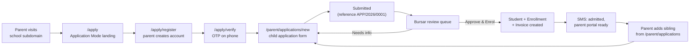
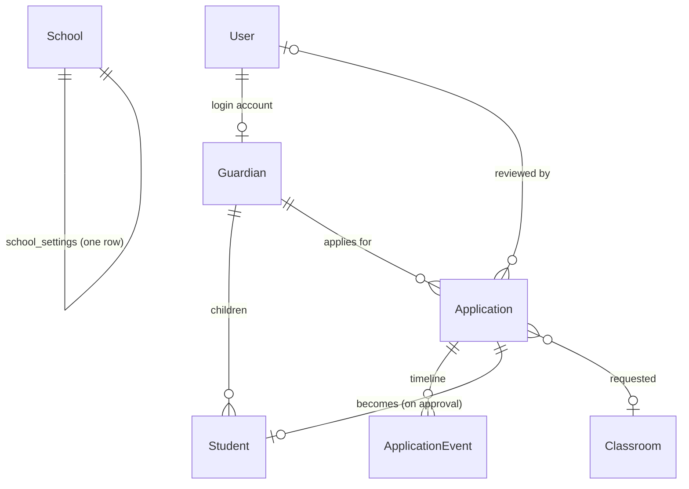
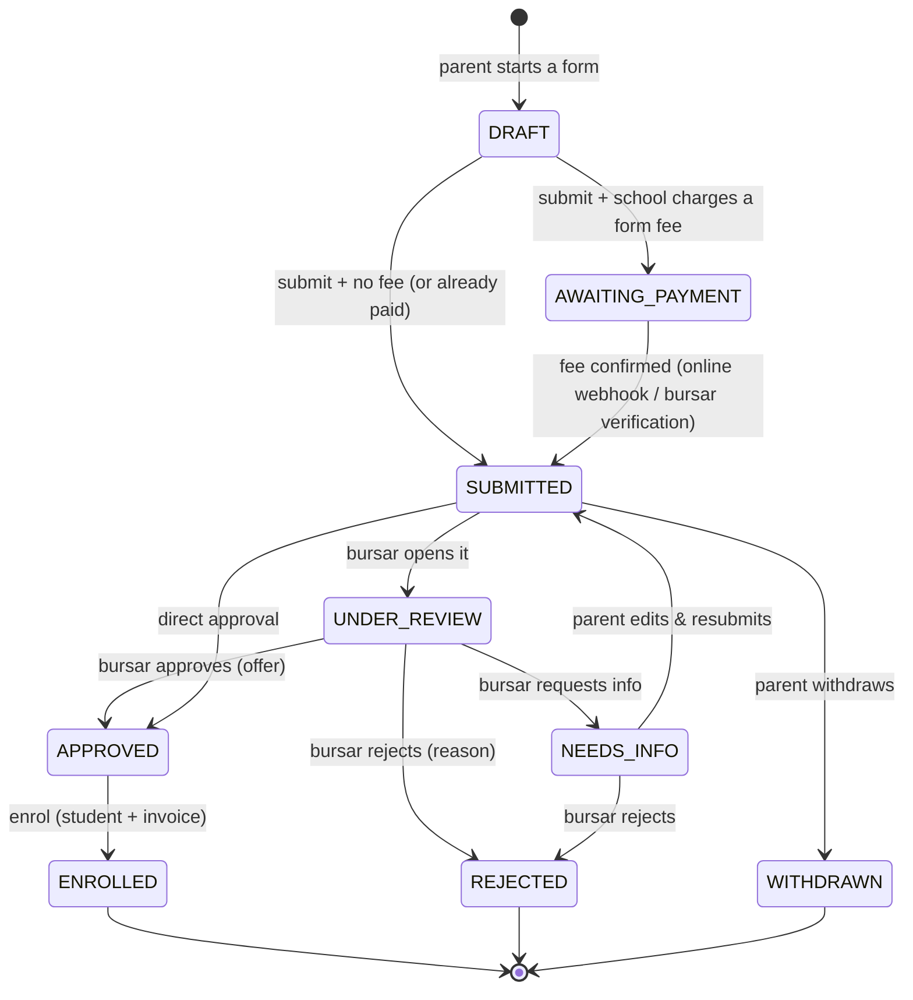

# Edus — Parent Self-Registration & Child Application (Design)

> **Status:** 🟡 DRAFT — for discussion. No code until §15 is agreed.
> **Module name:** *Application Mode* (parent-facing) / *Applications* (bursar-facing)
> **Surface:** tenant app — public site + parent portal + bursar back-office
> **Related docs:** `docs/exam-collection/INSTRUCTIONS.md` (build conventions), `FEATURES.md` §2

---

## 1. The problem we are solving

Today admissions are **100% back-office**. The bursar runs `AdmissionController`:

```
/admission            → create/find Parent (Guardian)   [bursar types everything]
/admission/register/{id} → register the child under that parent
                          → auto admission number + Enrollment + Invoice
```

This means a parent cannot apply on their own. Every new child — including a **sibling of a
child already in the school** — has to be typed in by a staff member, usually during the
September rush, one parent at a time, over the phone or at the counter.

**What we want instead:** the school can switch on **Application Mode**. Parents then
self-register a permanent parent-portal account and apply for their child from home, any
hour, and a bursar reviews and admits with one click.

The existing back-office flow is **not replaced** — it becomes the "walk-in" path and shares
the same admission engine (§9).

---

## 2. Goals / Non-goals

### Goals
1. **G1** — A parent can create their own account (email + phone + password) without staff help.
2. **G2** — That same account is their **permanent parent portal login** (fees, invoices, calendar, results).
3. **G3** — A verified parent can submit an **application per child**, one child at a time, and
   **add more children (siblings) later** under the same parent record.
4. **G4** — The bursar gets a **review queue** with filters, a timeline, and one-click **Approve & Enrol**.
5. **G5** — Approving uses the **exact same** admission number / enrolment / discount / invoicing
   logic as the walk-in flow (single code path).
6. **G6** — Parents are kept informed by SMS at every status change.
7. **G7** — An applicant can **never** appear in the student registry, results, store or invoices
   until they are admitted.

### Non-goals (v1)
- Online payment of an application/form fee — see **Q6** (kept as a hook, not built now).
- Entrance-exam scheduling, CBT tests, or interview booking.
- Recruitment of staff, alumni, or donations.
- Cross-school (landlord-level) application portals — this is per-school on its subdomain.
- Merging two existing Guardian/family records (a manual tool may be needed later — §16).

---

## 3. The three journeys



### 3.1 New parent (never dealt with the school)
1. Visits `school.edus.ng/admissions` → sees **"Apply Online"** (only when Application Mode is on).
2. `/apply` → school intro, requirements, open/close dates, and two buttons:
   *Start my application* / *I already have an account*.
3. `/apply/register` → name, email, phone, password (+ consent checkbox). Duplicate email/phone
   is detected and the parent is pushed to log in instead (§11.2).
4. `/apply/verify` → a **signed email link** proves the address is theirs. **No SMS OTP** — see
   `docs/authentication/VERIFICATION-AND-2FA.md`. TOTP (Google Authenticator) is offered as an
   optional second factor; SMS stays for notifications only.
5. Lands on **My Applications** with zero rows and a big **"Apply for a child"** button.
6. Fills the child form (multi-step, Alpine, **works offline** — §3.4), uploads passport photo +
   birth certificate, submits. **The application is not processed until the form fee is settled**
   (§6.2) — the parent sees *"Submitted — pay the ₦X form fee to start processing"*.
7. Sees the status timeline page. Gets SMS on submit, and on every later status change.

### 3.2 Existing parent (sibling already in the school)
1. Logs into the parent portal as usual (`/login`).
2. Sidebar now has **My Applications** (`/parent/applications`).
3. Clicks **Apply for another child** → same application form, guardian fields **pre-filled**
   from their `Guardian` record (read-only except where they may correct it).
4. Both children end up grouped under the same family — the bursar sees
   **"Applications from this family"** on the review screen.

### 3.3 Bursar / admin
1. Sees a badge on **Applications** in the sidebar (count of `SUBMITTED` + `UNDER_REVIEW`).
2. `/admission/applications` → queue with filters: status, class applied for, date range,
   search by reference / child name / parent phone.
3. Opens a row → child details, uploaded documents (view/download), guardian snapshot,
   **timeline**, and the action bar:
   **Request information** · **Reject** (reason required) · **Approve & Enrol**.
4. *Approve & Enrol* opens a small confirm panel: final `Classroom`, active `Session`/`Term`,
   optional discount override → confirms → student created + billed + parent SMSed.
5. The application leaves the queue and the child appears in the normal student registry.

### 3.4 Offline-first drafts (a busy parent must never lose work)

The form is long and the connection can drop mid-sentence, so the form is built to survive both.

- **Alpine.js owns the form state** (`x-data` on the wizard): step navigation, inline validation,
  conditional fields, and the state → LGA cascade (reusing the existing JSON endpoint).
- **Every change is written to IndexedDB** (`edus_application_draft`, debounced) so nothing is lost
  when the phone sleeps, the tab closes, or the network dies. `localStorage` is the fallback.
- **A service worker** (`public/sw.js`, registered from the public layout) caches the layout, the
  compiled CSS and Alpine, so **the page opens with no network at all**.
- **Two save layers, one winner:** the *server* draft (an `Application` row with `status = draft`,
  saved through `POST …/draft` as JSON) and the *local* draft (IndexedDB). On reopening, the newer of
  the two wins, with a visible *"Restored your unsaved work from this device"* notice.
- **Offline submit:** when there is no connection the service worker intercepts the POST, queues it
  (Background Sync where supported, otherwise a retry on the next visit) and shows
  **"Application ready — waiting for internet connection to submit."** with a *Retry now* button and
  a badge in the parent's list. The draft stays safe on the device until the server acknowledges it.
- **Never double-submit:** each submission carries a client-generated `submissionToken`; the server
  ignores a token it has already accepted (idempotent submit).
- **States the UI must show:** `Saved on this device` · `Saved to your account` ·
  `Waiting for connection` · `Submitting…` · `Submitted ✔`.
- **Budget:** the offline shell must stay small (see the payload budgets in
  `docs/architecture/REQUEST-RESPONSE-AUDIT.md` §6.4) — a 2G parent should be able to open the form
  again in a few seconds.

---

## 4. Where it lives (three surfaces, one engine)

| Surface | Auth | Routes | Templates |
|---|---|---|---|
| **Public "Application Mode"** | none | `/apply`, `/apply/register`, `/apply/verify`, `/apply/login` | `templates/tenant/apply/*` (extends `tenant/home/layout.html.twig`) |
| **Parent portal** | `ROLE_PARENT` | `/parent/applications/*` | `templates/tenant/parent/applications/*` (extends `base.html.twig` → sidebar) |
| **Bursar review** | `ROLE_BURSAR` | `/admission/applications/*` | `templates/tenant/admission/applications/*` (next to the existing admission pages) |

> **Why `/parent/applications` and not `/apply/applications`?** Keeping the authenticated
> screens under `/parent` means `^/apply` can be **entirely** `PUBLIC_ACCESS` and `^/parent`
> can be entirely `ROLE_PARENT` — no fragile rule ordering in `access_control`
> (the exact class of bug that broke `/admin` — see §13.2).

---

## 5. Data model

### 5.1 New entity: `Application` (`src/Entity/Tenant/Application.php`, table `application`)

> ✅ **Implemented** (24 Sep 2026) — created, linted and applied to all tenant databases with
> `app:tenant:update-schema`. Extra columns added beyond this table: the **form-fee gate**
> (`feeStatus`, `feeAmount`, `feeChannel`, `feeReference`, `feePaidAt`, `feePayment`, `feeProofFilename`),
> **draft resume** (`lastCompletedStep`), consent proof (`consentAt`, `consentVersion`) and `ipAddress`.
> `reference` is assigned **at submit**, so abandoned drafts never consume numbers.

One row = **one child's application**. A family with 3 children = 3 rows sharing one `guardian`.

| Group | Field | Type | Notes |
|---|---|---|---|
| id | `id` | int | |
| Reference | `reference` | string(20) unique | `APP/2026/0001`, generated server-side |
| | `source` | string(20) | `ONLINE` \| `PARENT_PORTAL` \| `BURSAR_ENTRY` |
| Applicant | `firstName`, `middleName`, `lastName` | string(100) | mirrors `Student` |
| | `dateOfBirth` | date_immutable | must be in the past |
| | `gender` | string(10) | Male \| Female |
| | `religion` | string(50) null | |
| | `nationalityId` | FK `Country` null | dropdown |
| | `stateOfOriginId` | FK `State` null | Nigerian states already seeded |
| | `lgaId` | FK `LGA` null | filtered by state, as the existing form does |
| | `homeTown` | string(100) null | |
| Health | `bloodGroup`, `genotype` | string(10) null | |
| | `medicalConditions` | text null | |
| Previous | `previousSchool` | string(255) null | |
| | `previousClass` | string(50) null | |
| Request | `requestedClassroomId` | FK `Classroom` null | "class applying for" |
| Guardian snapshot | `relationshipToStudent` | string(50) | Father / Mother / Guardian… |
| | `guardianName` | string(255) | snapshot (survives later edits) |
| | `guardianPhone`, `guardianAlternatePhone` | string(20) | |
| | `guardianEmail` | string(255) null | |
| | `guardianOccupation`, `guardianAddress`, `guardianOfficeAddress` | string/text null | |
| Documents | `passportPhotoFilename` | string(255) null | `uploads/applications/{reference}/…` |
| | `birthCertificateFilename` | string(255) null | |
| | `previousResultFilename` | string(255) null | |
| Links | `guardianId` | FK `Guardian` **not null** | family grouping / siblings |
| | `studentId` | FK `Student` unique null | set only on enrolment |
| | `reviewedByUserId` | FK `User` null | last staff action |
| Workflow | `status` | string(20) | see §6 |
| | `submittedAt`, `reviewedAt`, `enrolledAt` | datetime_immutable null | |
| | `decisionNotes` | text null | internal |
| | `infoRequestedNote` | text null | shown to the parent |
| | `rejectionReason` | text null | shown to the parent |
| | `offerExpiresAt` | datetime_immutable null | optional, if we offer slots |
| Meta | `ipAddress` | string(45) null | abuse trail |
| | `consentAt`, `consentVersion` | datetime/string null | NDPR consent proof |
| | `createdAt`, `updatedAt` | datetime_immutable | |

**Document handling:** three nullable filename columns instead of a separate table — matches the
existing style (`Student.profilePictureFilename`, `Payment.proofFilename`) and keeps v1 small.
If a school later needs unlimited attachments, add `ApplicationDocument` without touching this.

### 5.2 New entity: `ApplicationEvent` (`table application_event`)

The audit trail / **timeline**. Every status change writes one row. This is what makes the
parent's status page and the bursar's timeline "civil" (accountable) — and it mirrors the
`ResultApproval` idea of recording who did what.

| Field | Type | Notes |
|---|---|---|
| `id` | int | |
| `applicationId` | FK `Application` | `onDelete: CASCADE` |
| `fromStatus` | string(20) null | null on creation |
| `toStatus` | string(20) | |
| `actorUserId` | FK `User` null | null = system/parent |
| `actorLabel` | string(100) | "Parent", "Bursar: A. Musa", "System" |
| `note` | text null | reason / request |
| `createdAt` | datetime_immutable | |

### 5.3 Changes to existing entities

**`School`** (`school_settings`, `src/Entity/Tenant/School.php`) — new columns:

| Column | Type | Default | Purpose |
|---|---|---|---|
| `applicationsOpen` | bool | `false` | the **Application Mode** master switch |
| `applicationsOpenAt` / `applicationsCloseAt` | date_immutable null | null | display-only windowing |
| `applicationInstructions` | text null | null | shown on `/apply` (requirements list) |
| `applicationClassesNote` | text null | null | e.g. "Only JSS 1 and JSS 2 are open" |
| `applicationRequireApproval` | bool | `true` | if false, approval is instant-auto on submit (Q5) |
| `applicationFeeAmount` | decimal(10,2) null | null | reserved for Q6 (not enforced in v1) |

**`Guardian`** — new columns: `source` (string(20): `BURSAR` \| `SELF`), `isVerified` (bool),
`verifiedAt` (datetime_immutable null), `lastApplicationAt` (datetime_immutable null).

**`Student`** — **no changes.** This is deliberate: applicants live entirely in `application`
until admission, so no existing list, report, invoice, store or result query can accidentally
include a non-student. (Adding a `Student.status` column would mean auditing ~20 queries.)

**`User`** — no schema change. OTP codes live on `Guardian`/`User` transient columns
→ see Q3 for OTP storage (recommended: `Guardian.otpHash`, `Guardian.otpExpiresAt`, `Guardian.otpAttempts`).



### 5.4 Reference numbers

- Reuse the existing format family: admission numbers are `ADM/{YYYY}/{NNNN}`.
- Applications get **`APP/{YYYY}/{NNNN}`**, sequence = max existing sequence for the year + 1,
  generated **inside the same DB transaction** as the insert (the current `ADM/` generator uses
  `lastStudent->getId() + 1`, which is not race-safe — see §9.3).

---

## 6. Status machine



| Status | `const` | Who sets it | Parent sees |
|---|---|---|---|
| Draft | `STATUS_DRAFT` | parent (auto) | "In progress" + Resume |
| Awaiting payment | `STATUS_AWAITING_PAYMENT` | system, on submit | "Submitted — pay the form fee to start processing" + **Pay now** |
| Submitted | `STATUS_SUBMITTED` | system, when the fee is settled | "Received — awaiting review" |
| Under review | `STATUS_UNDER_REVIEW` | bursar (auto on open, optional) | "Being reviewed" |
| Needs information | `STATUS_NEEDS_INFO` | bursar + note | Note highlighted + **Edit & resubmit** |
| Approved | `STATUS_APPROVED` | bursar | "Approved 🎉" (+ slot expiry if used) |
| Enrolled | `STATUS_ENROLLED` | bursar (`Approve & Enrol`) | Admission number + portal access |
| Rejected | `STATUS_REJECTED` | bursar + reason | Reason |
| Withdrawn | `STATUS_WITHDRAWN` | parent | "Withdrawn" |
| Waitlisted *(optional)* | `STATUS_WAITLISTED` | bursar | "On waiting list" |

Convention: `public const STATUS_X = 'x'` — same style as `ResultApproval::STATUS_PENDING`.
Editable-by-parent statuses: **DRAFT** and **NEEDS_INFO** only. Everything else is locked.

### 6.2 The application-fee gate (a submitted form is not yet "processing")

A submitted application only reaches the bursar's queue once its fee is settled. The school's
`paymentMethod` decides **how** it settles (`offline` · `online` · `both` — see
`docs/payments/PAYMENT-COLLECTION.md`):

| School setting | Parent experience | `feeStatus` transitions |
|---|---|---|
| Fee amount empty/0 | Submits and goes straight to `SUBMITTED` | `unpaid → waived` |
| `offline` | Sees the school's bank details + their **application reference**, transfers, uploads the proof (`feeProofFilename`) | `unpaid → awaiting_confirmation → paid` (bursar confirms) |
| `online` / `both` | Clicks **Pay now** → gateway page → returns to the status page | `unpaid → paid` (gateway webhook) |

- Only `SUBMITTED` (i.e. fee-settled) applications appear in `/admission/applications`; the bursar
  queue has a **"Awaiting payment"** filter so the office can still see and chase them.
- The offline proof → confirm step deliberately mirrors the existing
  `PaymentController` proof-verification flow, so bursars already know it.
- Parent-side copy always explains **what happens next** and **how long it usually takes**.
- **Open:** refunds for rejected applications (see §15, Q11).

---

## 7. Routes & controllers

### 7.1 Public — `ApplicationController` (`src/Controller/Tenant/ApplicationController.php`)

| Method | Path | Route name | Purpose |
|---|---|---|---|
| GET | `/apply` | `app_tenant_apply_index` | Application Mode landing (or "closed" notice) |
| GET/POST | `/apply/register` | `app_tenant_apply_register` | parent self-registration (+ auto-login) |
| GET/POST | `/apply/verify` | `app_tenant_apply_verify` | OTP entry / resend |
| GET | `/apply/login` | `app_tenant_apply_login` | thin wrapper → existing tenant login |

All carry `host: '{subdomain}.%app.base_domain%'`.

### 7.2 Parent portal — `ParentApplicationController` (`/parent/applications`)

| Method | Path | Route name |
|---|---|---|
| GET | `/parent/applications` | `app_parent_applications_index` |
| GET/POST | `/parent/applications/new` | `app_parent_applications_new` |
| GET/POST | `/parent/applications/{id}/edit` | `app_parent_applications_edit` |
| GET | `/parent/applications/{reference}` | `app_parent_applications_show` |
| POST | `/parent/applications/{id}/submit` | `app_parent_applications_submit` |
| POST | `/parent/applications/{id}/withdraw` | `app_parent_applications_withdraw` |
| POST | `/parent/applications/{id}/delete` | `app_parent_applications_delete` (drafts only) |

`#[IsGranted('ROLE_PARENT')]` on the class + **ownership guard** on every action: the
application's `guardian.user` must be the current user (same pattern as
`app_parent_finance_view`, which verifies ownership so a parent only sees their own children).

### 7.3 Bursar — `ApplicationReviewController` (`/admission/applications`)

| Method | Path | Route name |
|---|---|---|
| GET | `/admission/applications` | `app_tenant_application_index` |
| GET | `/admission/applications/{id}` | `app_tenant_application_show` |
| POST | `/admission/applications/{id}/status` | `app_tenant_application_status` (needs info / reject / review) |
| GET/POST | `/admission/applications/{id}/enrol` | `app_tenant_application_enrol` (approve & enrol) |
| GET | `/admission/applications/{id}/document/{slot}` | `app_tenant_application_document` (stream/download, not a public URL) |
| GET | `/admission/applications/export` | `app_tenant_application_export` (CSV, like other modules) |

`#[Route('/admission/applications')]` + `#[IsGranted('ROLE_BURSAR')]`, sitting beside the existing
`AdmissionController` (`/admission`). Add a **"Applications"** sidebar item next to *New Admission*.

---

## 8. UI spec (page by page)

All pages use the **Tailwind CDN already loaded in `templates/base.html.twig`**, the school's
`primaryColor` as the accent, and the school's logo/name in the header.

**`templates/tenant/apply/layout.html.twig`** — minimal public shell (header with school brand,
footer with address/phone), modelled on `templates/tenant/home/layout.html.twig`. No sidebar.

1. **`/apply` (landing)** — hero with `heroTagline`; "Application Mode is open" pill;
   `applicationInstructions` rendered as a checklist; what happens next (3 steps); the child's
   documents needed; **Start application** / **I already have an account**; support contact;
   if closed → `applicationClassesNote` + "closes on …" notice.
2. **`/apply/register`** — 2-column form: parent name, email, phone, alternate phone,
   relationship, address; password + confirm (min 8, can't be `parent`/`12345678`);
   consent checkbox (required, links to a plain-language data-use note).
3. **`/apply/verify`** — 6 single-digit boxes (Alpine, auto-advance), "Resend code (0:45)",
   "Wrong number? Change it" (only before verification).
4. **`/parent/applications` (list)** — cards: child name, class applied for, status badge,
   reference, submitted date, last update; **Apply for another child** button; empty state
   explaining the 3 steps. Family header shows "Applications from your family (2 children)".
5. **`/parent/applications/new` (form)** — 5 Alpine tabs/steps with a progress bar:
   1. Child (names, DOB, gender, religion, photo upload)
   2. Origin & health (nationality, state → LGA cascade, hometown, blood group, genotype, medical)
   3. Previous school (name, class)
   4. Guardian (prefilled & read-only when the parent is logged in)
   5. Review & submit (summary + declaration checkbox)
   Save-as-draft at any step; leave & resume later.
6. **`/parent/applications/{reference}`** — status hero (big badge + "what happens next" sentence),
   the **timeline** (`ApplicationEvent`), documents uploaded, buttons: *Edit & resubmit*
   (only NEEDS_INFO), *Withdraw*, *Print application* (print CSS, like other print views).
7. **`/admission/applications` (queue)** — filter bar (status · class · date range · search),
   summary counters (New today / Awaiting review / Needs info / Approved this term),
   table with reference, child, class, parent + phone, submitted, status, actions.
8. **`/admission/applications/{id}` (review)** — two columns: child + guardian + documents (left),
   timeline + action panel (right). Action panel is the only place status changes happen.
   "Approve & Enrol" reveals the class/session/term selects and shows **what will be billed**
   (fee preview from `FeeStructure`) before confirming.
9. **Settings card** — `templates/tenant/settings/general.html.twig`: an **"Application Mode"**
   card (switch, open/close dates, instructions, classes note, approval toggle) + a link
   "View public admissions page ↗".

---

## 9. Reuse, not reinvention (the important part)

### 9.1 Extract an `AdmissionService`

`AdmissionController::register()` currently contains, inline: admission-number generation,
`Enrollment` creation, term/session resolution, `DiscountCalculator` usage, invoice + invoice
item creation, and SMS. The review flow needs **all of it**.

**Plan:** move that block into `src/Service/AdmissionService.php`:

```php
final class AdmissionService
{
    public function __construct(
        private EntityManagerInterface $em,
        private DiscountCalculator $discounts,
        private NotificationService $notifier,
    ) {}

    /** Create Student + Enrollment + Invoice for an admitted applicant. */
    public function admit(Student $student, Classroom $classroom, Term $term, ?Application $source = null): Student;

    public function generateAdmissionNumber(Student $student): string;

    /** Shared by walk-in and online flows. */
    public function billStudent(Student $student, Classroom $classroom, Term $term): ?Invoice;
}
```

Then:
- `AdmissionController::register()` → `$admissionService->admit(...)` (**behaviour-preserving refactor**).
- `ApplicationReviewController::enrol()` → `$admissionService->admit($studentFromApplication, …)`.
- `QuickAdmissionController::uploadCsv()` → can later call `generateAdmissionNumber()` too.

One code path for admission = no drift between online and walk-in students. **This is the
biggest consistency win of the whole module** and should be Phase 1, before any UI.

### 9.2 `ApplicationService`

`src/Service/ApplicationService.php` holds the workflow rules so controllers stay thin:
`createDraft()`, `submit()`, `requestInfo()`, `reject()`, `approve()`, `withdraw()`,
`toStudent()` (maps application fields → a `Student` instance), `logEvent()`.
Every transition validates "allowed from status X" and writes an `ApplicationEvent`.

### 9.3 Fix the admission-number generator while we are in there

Current logic:
```php
$lastStudent = $em->getRepository(Student::class)->findOneBy([], ['id' => 'DESC']);
$nextSequence = $lastStudent ? ($lastStudent->getId() + 1) : 1;
```
Problems: (a) uses the **row id**, so deleting/re-importing a student can produce duplicates;
(b) two simultaneous admissions can read the same "last" row. With an online queue, concurrency
is now real. Fix inside `AdmissionService`: derive the sequence from the **max existing
`ADM/{YYYY}/%` admission number** for the current year and retry on `UniqueConstraintViolation`,
inside the transaction. Report it as a "fixed while refactoring" item in the changelog.

### 9.4 Notifications — reuse `NotificationService`

`sendSms(TenantSchool $school, string $recipient, string $template, string $eventType, array $placeholders)`
already honours the tenant toggles and the SMS wallet. Add one toggle:
`School.smsOnApplication` (bool, default true) alongside `smsOnEnrollment`.

| Trigger | To | Placeholders |
|---|---|---|
| Account created + OTP | parent phone | `{code}`, `{school}` |
| Application submitted | parent phone | `{child}`, `{reference}` |
| New application submitted | bursar phone (setting) | `{child}`, `{parent}` |
| Needs information | parent phone | `{child}`, `{note}` |
| Approved | parent phone | `{child}` |
| Rejected | parent phone | `{child}`, `{reason}` |
| Enrolled | parent phone | `{child}`, `{admissionNumber}`, `{login}` |

---

## 10. Security, privacy & abuse

| Risk | Control |
|---|---|
| Spam registrations / fake applications | **OTP verification of phone before any application can be submitted** + rate limiting (§10.1) + honeypot field on the public forms |
| Enumeration of parent data | Registration must **never** say "this email exists" in a way that leaks data — show "we've sent a sign-in link/code to that number, please log in instead" (see §11.2) |
| Unauthenticated access to another family | Every parent action re-checks `application.guardian.user === currentUser` (ownership guard, same as the finance view) |
| Malicious uploads | Whitelist `jpg/jpeg/png/pdf`; max 3 MB images / 5 MB PDFs; random filenames; stored under `public/uploads/applications/{reference}/`; served **through a controller** (`X-Content-Type-Options`, `Content-Disposition: attachment`) so a `.php`/`.html` file can never execute or render |
| Applicant leaking into school data | `Student` is only created on approval; **no `Student` changes** at all |
| Tenant cross-contamination | Routes are on `{subdomain}.%app.base_domain%`; `TenantListener` swaps the DB before the controller runs. **Never** accept a school/database id from the request |
| CSRF | Symfony form CSRF on every POST (already the pattern) |
| Brute-forced OTP | 6-digit code, 15-min TTL, max 5 attempts, resend throttle 60 s, hash the code at rest |
| Data-protection (NDPR) | Explicit consent checkbox stored as `consentAt` + `consentVersion`; rejection/withdrawal anonymisation policy |
| Application documents retention | Rejected/withdrawn applications: documents deleted after N months (default 12), row kept as history — school-configurable (Q7) |

### 10.1 Rate limiting
`symfony/rate-limiter` is **not currently installed**. Add it and define two limiters in
`config/packages/rate_limiter.yaml`:
`application_register` (5/hour/IP), `application_otp` (5/hour/phone), `application_submit`
(10/day/guardian). Fallback if we don't add the package: an `application_throttle` table
(ip, action, count, window_start) — less clean, so I recommend the package.

---

## 11. Edge cases we must handle deliberately

1. **Duplicate family** — registration email/phone already exists in `guardian`:
   do **not** create a second Guardian. Respond: *"An account already exists for this number.
   We've sent a sign-in code."* → parent logs in with the OTP and is offered a password reset.
2. **Parent applies for a child already in the school** — match on `firstName + lastName + dateOfBirth`
   against that guardian's students; block submission with *"This child already has an admission
   record (ADM/2026/0031)."*
3. **Guardian with no students** — parents who registered but never enrolled must not break the
   parent directory, parent list, or SMS campaigns. **Audit these queries as a build task**
   (`ParentDirectoryController`, `StudentController`, exports).
4. **Application Mode switched off** — `/apply` shows a polite closed page (never a 404), and
   in-progress drafts are preserved; authenticated parents keep access to their existing applications.
5. **No active Session/Term when approving** — block *Approve & Enrol* with a clear message
   ("Set the active session and term first"), because billing depends on it.
6. **Class full / class applied for removed** — bursar may pick a different class at approval;
   `requestedClassroom` is only a request.
7. **Parent changes phone after registration** — phone is the OTP channel; a phone change
   re-triggers verification.
8. **Two parents, one child** (divorced parents, both with accounts) — v1: the second parent's
   application is flagged on submit ("A sibling already exists under another guardian"), left to
   the bursar. Full multi-guardian support is out of scope (Q8).
9. **Landlord (main) domain** — `/apply` exists **only** on tenant hosts; on `edus.ng` it must 404.
10. **The `/admin` lesson** — new public routes must be added to `access_control` **before** the
    `^/` catch-all, or the login page and every public page start bouncing (§13.2).

---

## 12. School settings (Application Mode card)

| Setting | Default | Effect |
|---|---|---|
| Application Mode | **off** | master switch for `/apply` |
| Open from / Closes on | empty | displayed on the landing page (no hard enforcement in v1 — Q4) |
| Instructions | empty | checklist shown on `/apply` |
| Classes note | empty | e.g. "JSS 1 and JSS 2 only" |
| Require bursar approval | **on** | if off, submitted applications are auto-approved (still need Enrol) — Q5 |
| Notify bursar on new application | **on** | SMS to the bursar phone when a parent submits |
| Application fee | *(reserved)* | disabled in v1 — Q6 |

---

## 13. Repo consistency rules (non-negotiable)

1. **Schema** — after any entity change run:
   `docker compose exec -T php bin/console app:tenant:update-schema`
   (`UpdateTenantSchemaCommand` loops every tenant DB and calls `SchemaTool::updateSchema()`, so new
   entities are created automatically; add an idempotent `ensure*()` fallback block only if we
   need it for brand-new tenants). Also verify with `app:tenant:verify-schema`.
2. **`config/packages/security.yaml`** — add, in order:
   ```yaml
   # ⚠️ MUST stay above the ^/ ROLE_USER catch-all (see the /admin login-loop incident)
   - { path: ^/apply$,            roles: PUBLIC_ACCESS }
   - { path: ^/apply/,            roles: PUBLIC_ACCESS }
   - { path: ^/parent/applications, roles: ROLE_PARENT }
   ```
3. **Uploads** — add the parameter next to the existing ones in `config/services.yaml`:
   `application_documents_directory: '%kernel.project_dir%/public/uploads/applications'`.
4. **Naming** — columns `snake_case`, properties `camelCase`, `*_at` timestamps,
   `datetime_immutable`, status constants as `public const STATUS_X = 'x'`.
5. **Templates** — all under `templates/tenant/…`; public pages extend the tenant *home* layout,
   authenticated pages extend `base.html.twig` (sidebar). Tailwind CDN only, no new build step.
6. **Sidebar** — add *Applications* in the `ROLE_BURSAR`/admission group and *My Applications* in
   the `ROLE_PARENT` block of `templates/base.html.twig` (near line 222/306).
7. **Print** — the parent's application summary reuses the existing print CSS pattern
   (`#sidebar` hidden in `@media print`).
8. **Docs** — update `FEATURES.md` (§ Admissions & Student Records → *Online Applications*) and
   `edus-official-user-manual.md` when the module ships.

### Files that will be touched (impact list)

| Action | File |
|---|---|
| **new** | `src/Entity/Tenant/Application.php`, `ApplicationEvent.php` |
| **new** | `src/Controller/Tenant/ApplicationController.php`, `ParentApplicationController.php`, `ApplicationReviewController.php` |
| **new** | `src/Form/ParentRegistrationType.php`, `ApplicationChildType.php`, `ApplicationReviewType.php` |
| **new** | `src/Service/AdmissionService.php`, `src/Service/ApplicationService.php` |
| **new** | `templates/tenant/apply/*`, `templates/tenant/parent/applications/*`, `templates/tenant/admission/applications/*` |
| **edit** | `src/Entity/Tenant/School.php` (+7 cols), `Guardian.php` (+4 cols) |
| **edit** | `src/Controller/Tenant/AdmissionController.php` (delegate to `AdmissionService` — no behaviour change) |
| **edit** | `config/packages/security.yaml`, `config/services.yaml`, `config/packages/rate_limiter.yaml` (new) |
| **edit** | `templates/base.html.twig` (+2 sidebar links), `templates/tenant/settings/general.html.twig` (+ card) |
| **edit** | `templates/tenant/home/admissions.html.twig` (+ "Apply Online" CTA when open) |
| **edit** | `composer.json` (+ `symfony/rate-limiter`) |

---

## 14. Build phases

**Phase 0 — Groundwork (no user-visible change)**
- [ ] `AdmissionService` extraction; `AdmissionController` delegates; regression-test a walk-in admission.
- [ ] Fix admission-number generation (unique, race-safe) + test.

**Phase 1 — Data model**
- [ ] `Application`, `ApplicationEvent`, `School` + `Guardian` columns.
- [ ] `app:tenant:update-schema` on all tenants; `app:tenant:verify-schema` clean.
- [ ] `SchoolSettingsController` + settings card (Application Mode toggle).

**Phase 2 — Parent account**
- [ ] `/apply` landing (open + closed states) and CTA on the public admissions page.
- [ ] `/apply/register` (+ duplicate detection), OTP send/verify, auto-login, rate limiting.
- [ ] `ParentRegistrationType` validation + consent.

**Phase 3 — Application form**
- [ ] `/parent/applications` list + family grouping.
- [ ] Multi-step child form, drafts, uploads, submit → reference number.

**Phase 4 — Bursar review**
- [ ] Queue with filters + counters + sidebar badge.
- [ ] Detail view + timeline + document viewer.
- [ ] Request info / reject / withdraw flows → SMS.
- [ ] **Approve & Enrol** → `AdmissionService::admit()` → student + enrollment + invoice; SMS.

**Phase 5 — Polish**
- [ ] Print application, CSV export, CSV of admissions-from-applications.
- [ ] Audit zero-student guardian handling in parent/directory queries.
- [ ] Docs: `FEATURES.md`, user manual, this file → status ✅ SHIPPED.

---

## 15. Decisions — answered 24 Sep 2026

| # | Decision | Outcome |
|---|---|---|
| Q1 | Verification channel | **Email verification link, not SMS OTP.** TOTP offered as a second factor → `docs/authentication/VERIFICATION-AND-2FA.md` |
| Q2 | Create the `Guardian` at registration | **Yes** — it is the permanent parent account; siblings group under it |
| Q3 | Where codes live | No OTP table: `User.totp_*` + `Guardian.email_verified_at` (**already added to the schema**) |
| Q4 | Open/close dates | **Display only** in v1 (master switch enforces) |
| Q5 | Can approval be switched off? | **Yes, as a school setting**, default ON |
| Q6 | Application fee | **Build it now** — the fee gates processing (§6.2). Two payment methods only: offline / online / both |
| Q7 | Document retention | 12 months for rejected/withdrawn, school-configurable |
| Q8 | Second parent on one child | v1 single guardian, duplicates flagged to the bursar |
| Q9 | Offer step? | **Approve = Enrol** in one action |
| Q10 | Who can review | `ROLE_BURSAR` and `ROLE_ADMIN` |
| — | Drafts | **Offline-first** (Alpine + IndexedDB + Service Worker + Background Sync) — §3.4 |
| — | UI polish & JSON standardisation | **Deferred** until the core module works → `docs/architecture/REQUEST-RESPONSE-AUDIT.md` |

### Still open

| # | Question | My recommendation |
|---|---|---|
| Q11 | Refund of the form fee when an application is rejected? | No automatic refund; the school decides case by case; show the policy on `/apply` |
| Q12 | Is the form fee paid **once per child** or once per family? | Per child (each application is independently processed) |
| Q13 | Payment provider + commission model (platform side) | See `docs/payments/PAYMENT-COLLECTION.md` §6 (P1–P7) |
| Q14 | Which email provider for verification mail? | See `docs/authentication/VERIFICATION-AND-2FA.md` §7 (A1) |

### Original questions (kept for reference)

| # | Question | Options | Original recommendation |
|---|---|---|---|
| Q1 | Should a parent's account be **verified by SMS OTP** before applying? | (a) yes, required (b) optional (c) email only | **(a)** — phone is the fee/notice channel; unverified numbers poison the SMS wallet |
| Q2 | Do we create the `Guardian` **at registration**, before any child exists? | (a) yes (b) only when the first application is submitted | **(a)** — it *is* the permanent parent account, and it makes sibling grouping trivial |
| Q3 | Where do OTP codes live? | (a) 4 columns on `Guardian` (b) new `verification_code` table | **(a)** — least schema, matches `Payment.proofFilename` style |
| Q4 | Are `applicationsOpenAt`/`CloseAt` **enforced** or just displayed? | (a) display only (b) hard close | **(a)** v1 — hard closes annoy parents mid-draft; the master switch is enough |
| Q5 | Can a school turn **off** bursar approval (instant "approved" on submit)? | (a) yes, school setting (b) always require approval | **(a)** but default ON |
| Q6 | Application/form **fee** now or later? | (a) later (b) now, pay-before-submit | **(a)** — column reserved now, feature later |
| Q7 | Retention for rejected/withdrawn **documents** | (a) 12 months (b) never auto-delete | **(a)**, school-configurable |
| Q8 | Second parent/guardian on one child | (a) v1 single guardian, flag duplicates (b) full multi-guardian | **(a)** |
| Q9 | Should approval require a **slot/offer** step (parent must accept) before enrolling? | (a) no — approve = enrol in one action (b) offer → parent accepts | **(a)** for v1; (b) is a Phase 5 option |
| Q10 | Who else can review applications besides `ROLE_BURSAR`? | (a) bursar + admin (b) bursar only | **(a)** `ROLE_BURSAR` \| `ROLE_ADMIN` |

**Next step:** `docs/parent-application/INSTRUCTIONS.md` — the phase-by-phase, file-by-file build plan in
the same shape as `docs/exam-collection/INSTRUCTIONS.md` — then we build strictly from it.

---

## 17. Implementation status

### ✅ Done (24 Sep 2026)

| Item | Where |
|---|---|
| `Application` entity (53 columns, 10 statuses, fee gate, draft resume) | `src/Entity/Tenant/Application.php` |
| `ApplicationEvent` entity (timeline / audit trail) | `src/Entity/Tenant/ApplicationEvent.php` |
| Application Mode settings + `payment_method` + SMS/bursar toggles | `src/Entity/Tenant/School.php` |
| `source`, `is_verified`, `verified_at`, `email_verified_at`, `last_application_at`, `applications` collection | `src/Entity/Tenant/Guardian.php` |
| TOTP fields (`totp_secret`, `totp_enabled`, `totp_enabled_at`, `totp_recovery_codes`) | `src/Entity/Tenant/User.php` |
| Schema applied to every tenant DB | `app:tenant:update-schema` |
| ⚠️ Fixed: stray blank line at the top of `AdmissionController.php` that made PHP throw
  *"Namespace declaration statement has to be the very first statement"* — a **fatal error for that file** | `src/Controller/Tenant/AdmissionController.php` |
| ⚠️ Found: `app:tenant:update-schema` fails on **`school_danlami`** because 1 `form_teacher` row
  references a `staff` row that does not exist (0 staff rows). Pre-existing data issue, unrelated to
  this module — needs a decision (delete the orphan row or restore the staff record) | `school_danlami` DB |

### ✅ Done (25 Sep 2026 — Phases 0, 1, 2 and 3 shipped)

**Phase 0 — groundwork**

| Item | Where |
|---|---|
| `AdmissionService` extracted; `AdmissionController::register()` now delegates | `src/Service/AdmissionService.php` |
| Admission-number generator fixed (was `lastStudent->getId() + 1`, not race-safe) | `AdmissionService::generateAdmissionNumber()` |
| ⚠️ Fixed a **fatal** stray blank line above `<?php` in `AdmissionController.php`
  (*"Namespace declaration statement has to be the very first statement"*) | `src/Controller/Tenant/AdmissionController.php` |

**Phase 1 — data model**

| Item | Where |
|---|---|
| `Application` entity (53 columns, 10 statuses, fee gate, draft resume) + `UNIQ_application_reference` | `src/Entity/Tenant/Application.php` |
| `ApplicationEvent` entity (timeline / audit trail) | `src/Entity/Tenant/ApplicationEvent.php` |
| Application Mode settings + `payment_method` + SMS/bursar toggles | `src/Entity/Tenant/School.php` |
| `source`, `is_verified`, `verified_at`, `email_verified_at`, `last_application_at`, `applications` | `src/Entity/Tenant/Guardian.php` |
| TOTP fields (`totp_secret`, `totp_enabled`, `totp_enabled_at`, `totp_recovery_codes`) | `src/Entity/Tenant/User.php` |
| Schema applied to every tenant DB; `messenger_messages` created in all three | `app:tenant:update-schema` |

**Phase 2 — parent account (verified end-to-end on 25 Sep)**

| Item | Where |
|---|---|
| `/apply` landing (open + closed), `/apply/register`, `/apply/verify/{id}`, `/apply/recover`, `/apply/login` | `src/Controller/Tenant/ApplicationController.php` |
| Duplicate detection: email match → neutral sent page; phone match with a *deliverable* stored email →
  sent page; phone match with an *undeliverable* (bulk-import placeholder) email → allow registration | same |
| `ParentRegistrationType` + consent + password rules | `src/Form/ParentRegistrationType.php` |
| Branded verification email (`Edus` envelope, school branding) | `src/Service/ApplicationMailer.php`, `templates/emails/parent/access_link.html.twig` |
| `app:mail:test <to>` + `bin/mail-check.sh` for delivery diagnosis | `src/Command/TestMailCommand.php` |
| **Verified live:** registration → Brevo SMTP → branded email received → signed link clicked →
  `is_verified=1`, `email_verified_at` stamped, parent signed in | `school_gobarau.guardian` row 7 |
| DNS fully configured: DKIM selector **`default`** (not `mail`), DMARC + `brevo-code`, custom MAIL FROM | `docs/operations/EMAIL-SETUP.md` |

**Phase 3 — the application form (built 25 Sep)**

| Item | Where |
|---|---|
| `ParentApplicationController` — `index`, `new`, `edit`, `show`, `submit`, `withdraw`, `delete`,
  `fee-proof`, `api/lgas/{id}`; `ROLE_PARENT` + per-application ownership guard on every action | `src/Controller/Tenant/ParentApplicationController.php` |
| `ParentApplicationType` — the five wizard steps; name/phone/email rendered disabled and re-stamped
  from the verified `Guardian` on every save, so the SMS channel cannot be tampered with | `src/Form/Tenant/ParentApplicationType.php` |
| List, wizard and detail/timeline pages + status pill partial | `templates/tenant/parent/applications/*` |
| Dashboard **Admission Applications** card + **📝 Admission Applications** sidebar item | `templates/tenant/parent/dashboard.html.twig`, `templates/base.html.twig` |
| Race-safe reference `APP/{YYYY}/{NNNN}` via `SELECT … FOR UPDATE` inside the insert transaction | `ParentApplicationController::generateReference()` |
| Fee gate implements §6.2: no fee → `FEE_WAIVED` + `SUBMITTED`; fee set → `FEE_UNPAID` +
  `AWAITING_PAYMENT`; offline proof upload → `AWAITING_CONFIRMATION`;
  `applicationRequireApproval = false` → straight to `APPROVED` | same |
| **Verified live:** 5-step wizard → submit → `APP/2026/0001`, `status=submitted`, `fee_status=waived`,
  `consent_version=v1`, `ip_address` recorded, timeline event written, detail and list pages correct | `school_gobarau` rows 1 |

### ⚠️ Deliberate deviations from this design (and why)

| Design said | Built | Reason |
|---|---|---|
| `GET /parent/applications/{reference}` | `GET /parent/applications/{id}` | `APP/2026/0001` contains `/`, so it cannot be a single URL path segment. The reference is still displayed and searchable. |
| Reuse `app_tenant_api_lgas` for the LGA cascade | New `app_parent_applications_api_lgas` | The staff endpoint sits behind `#[IsGranted('ROLE_BURSAR')]`, so a parent's fetch got a 403 that the client swallowed. Reference geography is not sensitive. |
| Step 3 of the form was to be 5 Alpine tabs + progress bar | Same, but panels toggle with `:style`, not `x-show` | With Alpine 3.x from the **floating `alpinejs@3.x.x` CDN**, `x-show`'s effect ran once at init and never re-ran; `x-text`, `:style` and `:value` all updated. Worth revisiting once that CDN is **pinned**. |
| Native HTML5 validation on the wizard | `novalidate` + server-side validation | A `required` field inside a hidden step makes the browser refuse to submit (*"invalid form control … is not focusable"*). The controller instead jumps to the first step containing an error. |
| `templates/tenant/parent/applications/*` extends `base.html.twig` | ✅ as designed | — |

### ⏭️ Next

**Remaining in Phase 3** (the wizard works, these make it survive a bad network — §3.4):
1. IndexedDB local drafts (`edus_application_draft`) + the "newer of the two wins" merge and the
   *"Restored your unsaved work from this device"* notice.
2. `public/sw.js` service worker: offline shell, queued submit, Background Sync, *Retry now*.
3. `submissionToken` idempotency so a retried submit cannot create two applications.
4. The §3.4 state pills: *Saved on this device · Saved to your account · Waiting for connection · Submitting…*
5. Performance: the LGA `<select>` currently renders all **774** LGAs before the cascade narrows it.
   Filter it by the already-selected state via `PRE_SET_DATA`.

**Phase 4 — bursar review** ✅ (built — see the implementation note below):
6. ~~`ApplicationReviewController` at `/admission/applications` + sidebar badge and counters.~~ ✅
7. ~~Detail view with document streaming, and **Approve & Enrol** → `AdmissionService::admit()`
   → student + enrollment + invoice, showing the fee preview before confirming.~~ ✅
8. Request info / reject / waitlist flows ✅. Still open: withdraw, fee-proof confirmation,
   SMS notifications (§9.4).
   *(Note: nothing currently sends SMS — `school.sms_on_application` is stored but unused.)*

#### Phase 4 implementation note (as built)

`ApplicationReviewController` at `/admission/applications`, `ROLE_BURSAR`:

| Route | Method | What it does |
|---|---|---|
| `app_tenant_application_index` | GET | Queue with counters (needs attention / new / under review / needs info / enrolled / rejected), search and status filter |
| `app_tenant_application_show` | GET | Review screen: child, guardian, documents, history, same-family siblings, decision panel. Opening a *submitted* application silently moves it to `under_review` |
| `app_tenant_application_document` | GET | Streams an uploaded document to a bursar only |
| `app_tenant_application_enrol` | POST | Approve & enrol → re-uses or creates the `Guardian`, builds the `Student`, calls `AdmissionService::admit()` |
| `app_tenant_application_status` | POST | Needs info / reject / waitlist / back to review |

Decisions worth keeping:

- **Documents are streamed, not linked.** They live in `public/uploads/applications/`, so a bare
  URL is served to anybody who guesses the filename — fine for a school badge, not for a birth
  certificate. The route checks `ROLE_BURSAR` and applies `basename()` so a crafted filename
  cannot escape the upload directory.
- **The guardian is matched by email, then phone, then created** — a second child from the same
  parent must not create a second guardian record.
- **`Student::$dateOfBirth` is mapped `type: 'date'`** (Doctrine `DateType`), which rejects a
  `DateTimeImmutable` with *"Could not convert PHP value of type DateTimeImmutable … Expected
  null, DateTime"*. A Symfony `DateType` form field returns a mutable `DateTime`, so the walk-in
  flow never hit this; the `Application` stores an immutable, so the review controller converts.
  Any future code copying a date from an application to a student must do the same.
- **Enrolment is transactional.** `AdmissionService::admit()` wraps student + enrollment + invoice,
  so a failure leaves nothing half-created (verified: the failed first attempt left `student_id`
  null and no orphan rows).


**Phase 5 — polish**
9. Print application, CSV exports, `FEATURES.md`/user manual updates, and the deferred UI-polish pass.

**Housekeeping**
10. `docs/parent-application/INSTRUCTIONS.md` was named in §14/§17 but never written; phases were
    driven from this file instead. Either write it or drop the reference.
11. 🔴 Pin the Alpine CDN and remove the unpinned `cdn.tailwindcss.com` (§13 / REQUEST-RESPONSE-AUDIT).
12. The `school_danlami` `form_teacher` orphan-row decision is still open (see the 24 Sep note below).

### 🗓️ Superseded "Next" list (24 Sep)
1. ~~`INSTRUCTIONS.md` build plan.~~
2. ~~**Phase 0** — extract `AdmissionService` …~~ ✅ done
3. ~~Settings card + `/apply` public landing page.~~ ✅ done
4. ~~Parent registration (email verification) → application form (offline drafts) → fee gate → review queue.~~
   Parent registration ✅, the application form ✅ and the review queue ✅ are done; offline drafts
   and the fee-proof confirmation step remain.

### 🕓 Deferred by decision (after the core works)
- UI polish pass on every page.
- JSON/response standardisation and the Tailwind-CDN removal (`docs/architecture/REQUEST-RESPONSE-AUDIT.md`).
- Online payment provider integration (`docs/payments/PAYMENT-COLLECTION.md`, phase 2).
- TOTP rollout for staff and admins (`docs/authentication/VERIFICATION-AND-2FA.md`, phase 2).

---

## 16. Out of scope / later

- Merging duplicate guardian records (admin tool).
- Waitlist ranking and automatic promotion off the waitlist.
- Entrance exam / interview scheduling and results.
- Uploading documents after submission (currently: only while DRAFT / NEEDS_INFO).
- Bulk approve for cohorts (e.g. "approve all JSS 1 applications").
- Public "check your application status" without an account (requires reference + DOB/phone).
- Unifying with `QuickAdmissionController`'s CSV import (should reuse `AdmissionService` once extracted).
