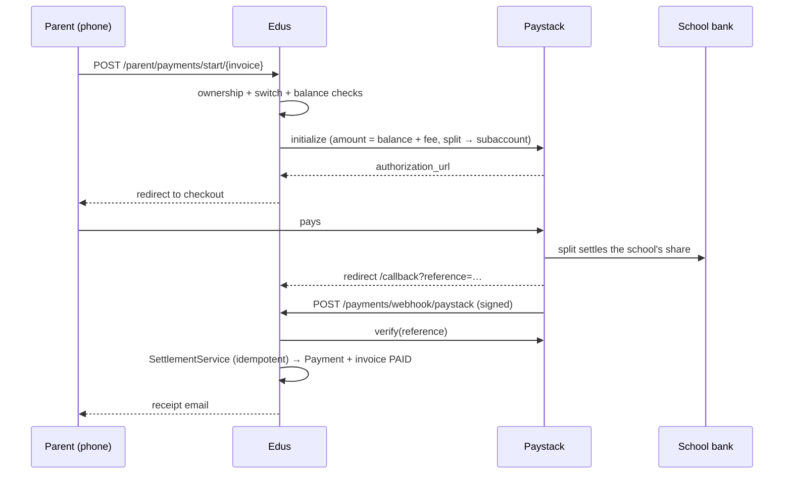

# Edus — Online payments and the application fee

> **Status:** � IMPLEMENTED — the capability trace and the switches are in the
> code, and the application-fee online payment shipped on **21 Oct 2026** (§3.7).
> **Pay-first (owner, 21 Oct 2026):** the fee is now settled *before* the form is
> filled — see §3.8. §3.4–§3.6 keep the reasoning and the decisions that shaped it.> **The ₦500 ceiling + the per-school switch (owner, 21 Oct 2026):** every online
> payment in the system — school fees and the form fee alike — is charged the same
> way, and a school can switch the charge off. See §4.> **Last traced:** 21 Oct 2026, against the code in `src/Service/Payment/`.
> **Read alongside:** `PAYMENT-COLLECTION.md` (the commercial rules),
> `PAYMENT-FLOW-DESIGN.md` (the original application-fee design),
> `SUBSCRIPTION-AND-TERM-REGISTRATION.md` (what a *school* pays Edus).

---

## 0. The short version

| Question | Answer |
|---|---|
| Can a parent pay **school fees** online today? | **Yes.** Paystack hosted checkout, split to the school's subaccount, receipt emailed, webhook-backed. |
| Can a parent pay the **application fee** online today? | **Yes.** Paystack hosted checkout, tagged `purpose = application_fee`; the fee lands in the ledger and the application enters the queue by itself. The offline proof path still works. |
| Is there a switch to turn online payment off? | **Two.** The operator has a platform-wide kill switch; each school chooses `offline` / `online` / `both` for itself. |
| Should the parent pay **before** or **after** admission? | Both, but they are two different ledgers (§3.4). The **form fee is paid before the form is filled** (§3.8); term fees gate *the student* after enrolment. |
| Should an unpaid parent be saved at all? | **Yes — but as a prospect that the school never sees as work.** Deleting the record costs more than it saves (§3.5). |

---

## 1. What online payment can do today (traced from the code)

### 1.1 Two switches and one credential

| Layer | Where | Stored as | Default |
|---|---|---|---|
| **Platform** (operator) | `/admin/settings` → "Online payments" | landlord `GlobalSetting` key `online_payments_enabled` | `missing row` = **enabled** |
| **School** (owner) | Settings → General → "School fees collection" (also in the website settings) | `school_settings.payment_method` = `offline` \| `online` \| `both` | DB `offline`, PHP property `both` ⚠️ see below |
| **Credential** | `.env.local` → `PAYSTACK_SECRET_KEY` | `%paystack_secret_key%` | absent → simulator |
| **Destination** | `school_settings.paystack_subaccount_code` | `ACCT_xxxx` | absent → real Paystack refused |

Classes: `App\Service\Payments\PlatformPaymentSwitch`,
`App\Entity\Tenant\School::acceptsOnlinePayment()`, `App\Service\Payment\GatewayFactory`.

> ⚠️ **Finding — the school default disagrees with itself.** The column says
> `options: ['default' => 'offline']` but the PHP property initialises to
> `PAYMENT_BOTH`. A row inserted by SQL defaults to *offline*; a row created in
> code defaults to *both*. New schools therefore behave differently depending on
> how they were created. This should be one value before the application-fee work
> starts — see §4 D1.

The effective rule, evaluated in three places (`OnlinePaymentController::onlinePaymentAvailable()`,
`ParentController::onlinePaymentAvailable()`, and the settings screen) is:

```text
online is offered  ⇔  platform switch ON
                    AND school.paymentMethod ∈ {online, both}
                    AND gateway configured
                    AND (paystack ⇒ subaccount code is set)
```

Any one of those false → the button is not rendered, and the POST endpoint refuses
with a flash message rather than a 500.

### 1.2 What a parent can do

| Capability | Where | Notes |
|---|---|---|
| See exactly what is owed and the extra charge | parent fee/invoice screen | amount + processing fee shown before leaving the site |
| Start a payment | `POST /parent/payments/start/{invoice}` | CSRF-protected, **POST only** (a link that moves money must not be prefetchable) |
| Pay by card / transfer / USSD | provider's hosted page | Paystack `authorization_url` |
| Resume a half-finished attempt | same endpoint | an existing `pending` intent is reused; double-tap cannot create two |
| Watch the payment confirm itself | `/parent/payments/{reference}` + `…/status.json` | polls the gateway; no manual refresh |
| Receive a receipt | `SettlementService` → `SchoolMailer::paymentReceipt()` | mail failure never rolls the money back |
| Pay for **their own** child only | `assertParentOwnsStudent()` | a guessed invoice id is a 403, not a view |

### 1.3 What the school and the platform get

| Guarantee | Mechanism |
|---|---|
| Money lands in the **school's** account (Edus never holds it) | Paystack split to `paystack_subaccount_code` |
| The school receives its **full** fee | the parent pays the gateway charge on top (`ProcessingFeeCalculator`) |
| The parent's charge is capped | **₦200 handling, total capped at ₦500** (`MAX_FEE`) |
| Two entry points can never disagree | callback **and** webhook both call `SettlementService` |
| Double settlement is impossible | `Payment.reference_code` is unique; `isSettleable()` checked first |
| A forged webhook is rejected | HMAC-SHA512 of the raw body, checked before parsing |
| The provider can retry for ever | handler is idempotent and answers 200 immediately |
| Every payment has an audit trail | raw gateway payload stored on the intent |
| Testing never moves real money | `FakeGateway` + `/payments/fake-checkout/{ref}` when no key is configured |
| A rejected transfer is not revenue | `bank.transfer.rejected` → intent `failed`, invoice untouched |

### 1.4 What is **not** implemented

**Closed on 21 Oct 2026:** the application-fee payment itself, `invoice_id`
nullability on the intent, the `purpose` tag, the `application` link, and the
missing `Payment` row for form fees. See §3.7.

| Gap | Consequence today |
|---|---|
| No expiry / temporary account | the shipped flow uses hosted checkout, so there is no DVA and no countdown. `PAYMENT-FLOW-DESIGN.md` §5 still describes the old design |
| No refund automation | a wrong-amount transfer is rejected by the provider; Edus does not issue refunds itself |
| Subscription payments are separate | the school's own Edus bill goes through `PaystackClient` + `SubscriptionController`, not this gateway |
| No stale-draft purge yet | §3.5 rule 3 is agreed but not scheduled; drafts survive indefinitely |

### 1.5 The journey that works today



---

## 2. Turning it on and off

### 2.1 Operator (us) — stop everything, everywhere

1. Sign in to the **landlord** portal (`/admin`).
2. **Settings → Online payments** (`/admin/settings`).
3. Toggle **off**. Every school is affected immediately; no tenant database is touched.

What it does: `PlatformPaymentSwitch::isEnabled()` returns false → the pay button
disappears and `POST /start` refuses. A **school's own setting is preserved** and
comes back when the switch is turned on again.

### 2.2 School (owner) — choose the collection method

**Settings → General → "School fees collection"** (or the website settings screen):

| Value | Meaning for parents |
|---|---|
| `offline` | transfer to the school account, upload proof, bursar confirms |
| `online` | pay through Paystack; no manual verification |
| `both` | the parent chooses — the recommended default for a school that has both |

Only the **school owner** (`ROLE_TENANT_SUPER_ADMIN`) can open this screen; a
principal cannot change how the school collects money.

### 2.3 Developer / keys

| Situation | Behaviour |
|---|---|
| No `PAYSTACK_SECRET_KEY` | `FakeGateway`; the whole journey works against `/payments/fake-checkout/{ref}` |
| Key present, no subaccount | real Paystack refused by `onlinePaymentAvailable()`; button hidden |
| Key present + subaccount | live money |

`PAYSTACK_SECRET_KEY` lives in `.env.local` (gitignored) and `%paystack_secret_key%`;
never in `compose.yaml`.

### 2.4 What each combination looks like to a parent

| Platform | School | Result |
|---|---|---|
| off | anything | no online option; offline proof only |
| on | `offline` | no online option; offline proof only |
| on | `online` | online only |
| on | `both` | both, parent chooses |
| on | online/both but no key | simulator in dev; hidden in production |

### 2.5 Money already in flight

Switching online payment **off** must never lose a payment that is already with
the provider:

- an intent already `pending` can still settle — the callback and the webhook do
  not consult the switch;
- the switch only prevents **new** attempts.

This is deliberate. It is the only ordering that cannot take a parent's money and
then refuse to record it.

### 2.6 The online charge — ₦500, and one switch (owner, 21 Oct 2026)

> "We want it carved at five hundred… the remaining is our own charge."

**Every** online payment the system takes is charged the same way — a term's school
fees and an application form fee alike — because the gateway's cut is a property of
the payment, not of what is being paid for.

| Part | Amount |
|---|---|
| Paystack transfer rate | 1% of the amount, capped at ₦300 |
| VAT on that charge | 7.5% |
| Edus handling | ₦200 |
| **The parent pays** | **the smaller of that total and ₦500** |

| Fee | Gateway + VAT | Handling | Parent pays |
|---|---|---|---|
| ₦5,000 | ₦53.75 | ₦200 | **₦253.75** |
| ₦25,000 | ₦268.75 | ₦200 | **₦468.75** |
| ₦30,000 | ₦322.50 | ₦200 | **₦500.00** *(capped)* |
| ₦68,600 | ₦322.50 | ₦200 | **₦500.00** *(capped — proved live)* |
| ₦250,000 | ₦322.50 | ₦200 | **₦500.00** *(capped)* |

The ceiling starts to bite at about **₦27,900**. Beyond that the school fee can
double and the parent's charge does not move — which is the whole point: the
charge is a transaction cost, not a percentage of a child's tuition.

**The switch.** Settings → General → **“Parent pays the online payment charge”**
(`School::$onlineProcessingFeeEnabled`, column `online_processing_fee_enabled`,
default **on**).

| State | Parent pays | Who absorbs the gateway cut |
|---|---|---|
| **On** (default) | fee + charge (max ₦500) | nobody — the school receives its fee in full |
| **Off** | exactly the fee | the school, out of its settlement |

**Where the code lives**

- `ProcessingFeeCalculator` — the maths and the ₦500 constant. Nothing else may
  hard-code a rate.
- `PaymentChargePolicy` — the per-school yes/no. Every entry point asks **it**, not
  the calculator: invoice start, application-fee start, and the fee cards that show
  the button total. That is what keeps the button and the checkout in agreement.
- The charge is **never school income**: the `payment` row records the fee only
  (₦68,600), while the intent records what the parent actually paid (₦69,100).

When the switch is off, every “the school receives the full amount” sentence is
hidden too — the parent is told the school covered the charge instead.

---

## 3. The application fee — the decision we need

### 3.1 What happens today (pay-first, since 21 Oct 2026 — see §3.8)

`ParentApplicationController`:

1. The parent taps **Apply for a child** → an application **shell** is created with
   the fee stamped on it (`awaiting_payment`, `unpaid`). No child details, no
   reference number, and it is not in the school's queue.
2. The wizard is **locked**: `/{id}/edit` redirects to the pay screen until the fee
   is paid or waived.
3. The parent pays online, or uploads a transfer receipt → `awaiting_confirmation`.
4. A bursar confirms, rejects or waives it.
5. Once settled, the application becomes `draft` and the **form opens**.
6. The parent fills the five steps and submits → `submitted` (or `approved` when
   review is off) and only then is `APP/2026/NNNN` assigned.

This replaced the older "fill first, pay at the gate" flow, which let a parent
complete the wizard before any money moved.

### 3.2 The demo finding

A parent registered on the website, created an account, applied for a child — and
**was never asked to pay**. The school's `applicationFeeAmount` was chargeable,
but the only path to pay was a bank transfer plus a receipt upload that the parent
was not prompted through. The application sat in `awaiting_payment`, invisible to
the bursar, with no way forward that the parent could find.

That is not a missing feature so much as a **dead end**: the gate existed, but the
door had no handle.

### 3.3 The question

> "Is it that to track the fee **before** the admission, or to track the fees
> **after** admission?"

They are not alternatives. They are two different obligations, owed at different
times, by different entities, for different reasons:

| | **Application fee** | **School fees** |
|---|---|---|
| When | before admission | after enrolment, every term |
| Belongs to | the **application** | the **student** |
| Paid by | the guardian | the guardian, for the student |
| Amount | one fixed form fee, school-wide | a fee schedule by class |
| Refundable | normally not | credited to the student's account |
| Gates | whether the school processes the application | whether the student's account is clear |
| Report | application-fee income | fee collection / debtors |
| Ledger today | `application.fee_*` columns | `invoice` + `payment` |

**Recommendation: keep them separate, and track the form fee before admission.**
Trying to make the term-fee ledger carry the form fee is what produces the
"meaningless records" problem — an applicant who is not yet a student would need a
student row and an invoice to hold a ₦5,000 form fee, and every rejected applicant
leaves a phantom debtor behind.

### 3.4 Recommendation in one line

> The form fee is the price of **being considered**. The term fee is the price of
> **attending**. One gates the application, the other gates the student — never mix
> them in one ledger.

### 3.5 Parent records without the noise

The concern is real: a school should not accumulate thousands of half-finished
parents. But the answer is **state**, not **absence**. Three options:

| | **A. Save as now, mark the lifecycle** *(recommended)* | **B. Save nothing until the fee is paid** | **C. No application fee at all** |
|---|---|---|---|
| Parent account | created immediately (it is their portal login) | created only on payment | created immediately |
| Application | saved as `draft` / `awaiting_payment` | held in a temporary store until paid | saved, processed free |
| If they never pay | a prospect, invisible to the school; purged after N days | nothing to purge — but also nothing to resume | a free application in the queue |
| They come back next week | same draft, same answers | must retype everything (or a signed token must survive) | n/a |
| Email verification | possible before paying | impossible until after paying | possible |
| Duplicate risk | one draft per child (already enforced) | high — the callback must dedupe identity | low |
| Audit trail | complete | only for payers | complete |
| School's queue | clean **if** `awaiting_payment` is excluded | clean | cluttered with unpaid work |
| Build cost | small | medium–large (temporary store, token, cleanup, reconstruction) | small |

**Choose A.** B sounds tidier but it trades a database row for a much harder
problem: the parent's ten minutes of typing lives nowhere, the callback has to
rebuild a guardian from a payment payload, and "pay first, register after" cannot
verify an email before money moves.

The noise problem is solved by three cheap rules, none of which require deleting
anything:

1. **Never assign a reference number before payment.** Already true.
2. **Never show `awaiting_payment` in the bursar's queue, the dashboard counts or
   the fee reports.** Already true for the queue; the report filters by status.
3. **Purge stale drafts.** A draft or an `awaiting_payment` application untouched
   for 30 days is deleted by a scheduled command, together with its guardian if
   that guardian has no other application and never paid.

### 3.6 A lifecycle for the guardian

Today `Guardian` has `isVerified` (email) and nothing else. Proposal:

| State | Meaning | Shown to the school? |
|---|---|---|
| `prospect` | registered, no paid application | no |
| `pending_payment` | submitted an application, fee outstanding | no (the application is not in the queue) |
| `active` | has at least one paid application or enrolled child | yes |
| `dormant` | no activity for 30 days, nothing paid | no; eligible for purge |

This replaces "regarded as an inactive parent" with something the system can
actually act on, and it is one nullable column plus a scheduled transition.

### 3.7 The online form fee — as built (21 Oct 2026)

One intent table, one gateway, one settlement path. Only the bookkeeping differs.

| Change | Detail |
|---|---|
| `PaymentIntent` | `purpose` (`invoice` \| `application_fee`), nullable `invoice_id`, new `application_id`, `getPayer()`, `isApplicationFee()` |
| `Payment.invoice_id` | Made nullable — a form fee is real money with no invoice until the child enrols |
| `OnlinePaymentAvailability` | The four-condition check (platform switch, school opt-in, configured gateway, subaccount) now lives in one service instead of two private controller methods |
| `POST /parent/payments/application/{id}` | Creates or resumes one pending intent per application; CSRF `pay_application_{id}`; ownership is the guardian's |
| `SettlementService::settleApplicationFee()` | Creates the `Payment`, sets `feePayment/feeStatus/feePaidAt/feeChannel/feeReference`, moves `awaiting_payment → submitted` (or `approved` when review is off), writes an `ApplicationEvent` |
| Parent screens | The fee block offers **Pay ₦X online** with the exact total (fee + processing, capped at ₦500), or the transfer + proof form when the school takes both |
| Status screen | `tenant/parent/application_payment_status.html.twig` — polls like the invoice page, shows the application reference, and retries on failure |

**Guards**

- A receipt already uploaded (`awaiting_confirmation`) blocks online payment — no
  family pays twice by accident.
- If a bursar confirms a proof while an intent is still open, the late webhook
  records the attempt **without** creating a second ledger row (`SettlementService`
  logs it as a refund check).
- `Payment.reference_code` is the intent reference, so a replayed webhook cannot
  duplicate the money.

**Proved end-to-end** on the demo school with the simulated gateway: ₦5,000 fee +
₦253.75 processing → intent `paid`, a `Payment` of ₦5,000 with a null invoice,
application `submitted` with `feeStatus = paid`, `feeChannel = online_gateway`, and
one timeline entry "Application fee paid online". Reloading the status page twice
created no second payment.

### 3.8 Pay-first (owner decision, 21 Oct 2026)

> "A parent must make payment first before they can fill the form."

| Step | State | What the parent can do |
|---|---|---|
| Taps **Apply for a child** | `awaiting_payment`, `feeStatus = unpaid`, fee stamped, **no reference** | Pay online, or upload a transfer receipt. Nothing else. |
| Fee confirmed (online settlement, bursar confirm, or waive) | `draft`, `feeStatus = paid`/`waived` | The five-step form is open. |
| Fills and submits | `submitted` (or `approved`) | Gets `APP/2026/NNNN` and the application joins the school's queue. |

**Rules**

- **One unpaid shell per guardian.** Tapping Apply again reopens the same shell
  rather than creating a second empty application.
- **No reference until submit.** `APP/2026/NNNN` belongs to a completed
  application, not to a fee purchase.
- **The wizard is guarded server-side.** `/{id}/edit` redirects to the pay screen
  when `hasPassedFeeGate()` is false; `finalizeSubmission()` refuses to proceed as
  a last line of defence.
- **Legacy drafts heal themselves.** A draft created by the old flow with an unpaid
  fee is moved to `awaiting_payment` the first time the parent opens it.
- **The fee confirmation does not submit the application.** It sets `draft` and
  writes a timeline entry: *"Application fee paid online. You can now complete the
  application form."*

### 3.9 Class level, not arm

The wizard offers **classes without arms** — `JSS 1`, `JSS 2`, `JSS 3` — stored on
`Application.requestedYearGroup`. The arm (`JSS 1A`) is the **principal's decision
at admission**: the school's enrolment form asks for it and refuses an arm outside
the requested level. `Application.requestedClassroom` is kept read-only for
applications created before this rule.

Proved: the parent saw `JSS 1 / JSS 2 / JSS 3`; the bursar's enrol form offered
`JSS 1A · JSS 1B · JSS 1C …` with **JSS 1A** preselected because the parent asked
for JSS 1.

---

## 4. Decisions to sign off

| # | Decision | Recommendation |
|---|---|---|
| D1 | School default collection method | **`both`** — align the DB default with the PHP property |
| D2 | Application fee: before or after admission? | **Before** — it is the gate that buys processing |
| D3 | Unpaid parents saved? | **Yes**, as `prospect`/`pending_payment`; never in the school's queues |
| D4 | Purge stale drafts? | **Yes**, 30 days, with the guardian if they have nothing else |
| D5 | Online form fee | **Build it** on the existing intent + settlement, purpose-tagged |
| D6 | Fee if the school is `offline` only | **No** online form fee; proof upload only (same as term fees) |
| D7 | Platform switch OFF | **No new** online attempts; in-flight payments still settle |
| D8 | Who may change the school's collection method | **School owner only** (`ROLE_TENANT_SUPER_ADMIN`) |
| D9 | The parent-paid online charge | **Capped at ₦500**, identical for school fees and the form fee (§2.6) |
| D10 | Can a school refuse to pass the charge on? | **Yes** — one toggle, default on; the school then absorbs the gateway cut |
| D11 | Who approves and enrols a new intake | **Administrator / principal only.** The bursar verifies money, not admissions |

---

## 5. Data model changes, if D5 is approved

| Change | Why |
|---|---|
| `payment_intent.purpose` (`invoice` \| `application_fee`) | one intent table, two jobs |
| `payment_intent.invoice_id` → nullable | an application fee has no invoice |
| `payment_intent.application_id` → nullable FK | resume + audit per application |
| `guardian.status` (`prospect`/`pending_payment`/`active`/`dormant`) | §3.6 |
| `Application.feePayment` actually set on settlement | fee income enters the ledger |

Migrations run through `app:tenant:update-schema` for every tenant.

---

## 6. Test plan (before go-live)

| # | Scenario | Expected |
|---|---|---|
| 1 | Pay form fee online (fake gateway) | intent → paid → application `submitted`, reference assigned |
| 2 | Pay, then webhook arrives again | no second payment row |
| 3 | Open the pay page twice | one intent, not two |
| 4 | Abandon checkout | application stays `awaiting_payment`, draft answers intact |
| 5 | School is `offline` | no pay button; proof upload works |
| 6 | Platform switch off | no new attempts; a pending intent still settles |
| 7 | Guardian pays for another guardian's application | 403 |
| 8 | Bursar confirms a proof, then a webhook arrives for the same application | no duplicate |
| 9 | Wrong amount transfer | `bank.transfer.rejected` → failed; application still payable |
| 10 | 30-day stale draft | purged; guardian purged only if they have nothing else |

---

## 7. The bursar's verification queue (implemented 21 Oct 2026)

Offline money still needs a human. The parent transfers with their slip code in the
narration, or — when the code never made it into the narration — uploads a receipt.
Either way the school's job is the same: find the money, and say yes.

**What was missing:** there was a code-lookup box, linked from nowhere, and the
dashboard said nothing about payments waiting. A bursar had to already know the
code to see a payment.

**What exists now**

| Piece | Where |
|---|---|
| **Queue** | Finance → **Verify Payments** (`/finance/payment/verify`), oldest first |
| **Dashboard counter** | "Awaiting verification" card + a "Your work" row with the amount claimed |
| **Search** | pupil name, admission number, guardian name/phone, slip code, bank reference, invoice number, exact amount |
| **Proof** | the parent's uploaded receipt opens inline, with its upload time |
| **Approval** | the bursar must **type the amount they saw in the bank** before the button works |

**Approval rules**

1. **CSRF is required.** The old endpoint had no token at all, so any page could
   POST an approval on a bursar's session.
2. **The amount is mandatory.** A blank box is never a confirmation.
3. **A different amount needs an explicit tick.** If the typed figure differs from
   the slip by more than ₦0.01, the request is refused until the bursar ticks
   "the bank shows a different amount". Then the typed figure becomes the recorded
   amount — which is how a part payment or a bank charge is captured honestly.
4. **A fully paid invoice is still blocked** and the stale slip is cancelled.
5. **The bursar returns where they came from** — queue → queue, terminal →
   terminal, register → register (`return_to`).

The receipt, SMS and email fire exactly as before, from the same confirm endpoint.

**Why the amount is retyped rather than just displayed:** a queue that only needs
one click becomes a rubber stamp by the twentieth item. Making the figure pass
through the bursar's hands — from the bank screen to the keyboard — is the cheapest
control that actually catches a mismatch.

---

## 8. Notes on stale documents

`PAYMENT-FLOW-DESIGN.md` describes the **first** design for this flow: a temporary
Paystack virtual account per payment, a countdown, `expectedAmount`, `providerAccountNumber`.
What shipped is **hosted checkout** (`authorization_url` + `accessCode`), which is
simpler and needs no DVA. That document is still useful for its state machine and
edge cases, but §5 and §6 of it no longer describe the implementation. Keep it for
the reasoning, read this file for the truth.

---

## 9. Part payments — the receipt says what is left (owner, 21 Oct 2026)

> "Some parents are used to paying part payment… show on their payment receipt
> what they have paid and what is their balance, so from their first receipt they
> know what is left."

Part payment has always been *possible* — the bursar's cash form and the
verification queue both accept any amount below the balance, and the invoice moves
to `PARTIAL` — but the receipt only printed the amount handed over. A parent who
paid ₦20,000 of ₦62,500 had a receipt that proved the payment and said nothing
about the ₦42,500 still owed.

### 9.1 What a receipt now shows

| Row | Source |
|---|---|
| **Amount paid** (this receipt) | `payment.amount` |
| Invoice total | `invoice.totalAmount` |
| Scholarship / discount | `invoice.discountApplied`, shown only when > 0 |
| Paid to date — *includes this receipt* | `invoice.paidAmount` |
| **Balance remaining** | `invoice.balanceDue` — red when > 0, green `fully settled` at zero |

Under the table, one sentence names the exact figure still to pay and the two ways
to pay it (portal, or transfer + receipt upload), and says part payments are
accepted. At zero it says nothing further is owed.

The emailed receipt (`templates/emails/parent/payment_receipt.html.twig`) already
carried `Invoice total` / `Total paid` / `Balance left`; the printed receipt now
matches it word for word in spirit.

### 9.2 Where it appears

- `templates/tenant/payment/receipt.html.twig` — the on-screen/printed fee receipt
  (bursar and parent both reach it).
- `templates/tenant/payment/walkin_receipt.html.twig` — one line of balance for a
  part-paid store sale.
- Unchanged and already correct: the email receipt, the invoice list (`Due: ₦X`,
  `Partial` badge) and the PDF statement.

### 9.3 Rules

- **Paid to date is read live**, not snapshotted. A reprinted receipt shows the
  position today, which is the number a parent needs when they are standing at
  the bank.
- **A part payment never touches the processing charge** — the ₦500 cap applies to
  an online checkout, not to cash at the desk.
- **The online button still pays the whole balance.** Splitting a payment across
  instalments online would need an amount field plus a per-payment cap recalculation
  — deliberately not built yet; it is a one-line change to `OnlinePaymentController`
  if the owner wants it.

