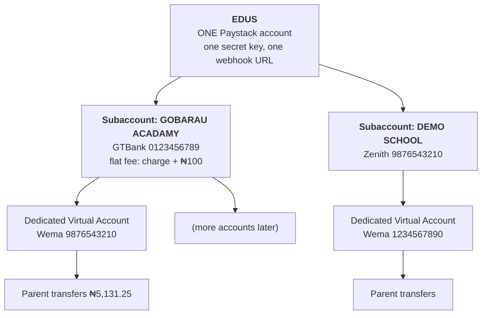

# Edus — payment accounts, VAT, reconciliation & settlement — explained

> **Companion to `PAYMENT-COLLECTION.md`.** That file is the options research and the decisions.
> This file answers the *mechanics* questions: what exactly is a subaccount, who needs a Paystack
> account, what VAT applies to, how one account can reconcile many parents, and when money actually
> lands in the school's bank.
>
> **Verified** against Paystack's documentation on **25 Sep 2026** unless marked otherwise.
> ⚠️ Re-verify before go-live — provider rules and rates change.

---

## 1. The account structure — who has what

**A school does NOT need a Paystack account.** This is the single most misunderstood part.

Edus has **one** Paystack account. Everything else lives inside it. The school's only involvement is
**giving us their bank account number**.

| Thing | What it actually is | Who creates it | Does the school log in anywhere? |
|---|---|---|---|
| **Paystack account** | A merchant login with API keys, KYC and a settlement bank | Paystack, for **Edus** | **No** |
| **Subaccount** | A *record* on Edus' Paystack account holding: the school's bank name + account number + how the money splits. **It is not a login and has no keys.** | We create it via `POST /subaccount` | **No** |
| **Dedicated Virtual Account** | A real NUBAN issued under Edus' account, optionally split to a subaccount | We create it via `POST /dedicated_account` | **No** |
| **Settlement** | Paystack pays the school's bank from the subaccount details | Paystack, automatically | Their own bank app |

**Onboarding a school therefore = "send us your bank account number".** No Paystack signup, no API
keys from them, no KYC for them with Paystack. That is a very strong sales story, and it is why
**model C** is the right architecture (`PAYMENT-COLLECTION.md` §4).

---

## 2. The 1,000 limit — scope matters enormously

Paystack's default is **1,000 dedicated virtual accounts per merchant account**, raised on request.
That limit sits on **Edus'** account, **across every school on the platform**.

| Scope | What 1,000 accounts means for Edus | Verdict |
|---|---|---|
| **One per school** | **1,000 schools** onboarded | ✅ **Right level.** The limit scales with our business, not a school's |
| One per parent | 1,000 families **total, platform-wide** | ❌ Unusable |
| One per student | ~1,000 students — i.e. **one school** | ❌ Fatal |

> ⚠️ **Correction to an earlier recommendation.** `PAYMENT-COLLECTION.md` §8.2 originally recommended
> "one DVA per parent". That was wrong for exactly this reason: it would cap the entire platform at
> 1,000 families. **One DVA per school is correct**, and it was the owner's instinct that caught it.

> 🔴 **But read §7 before building on this.** Per-school accounts solve the *account budget* and still
> lose at *matching* once a school has hundreds of payments in flight. Paystack's **Pay with Transfer**
> (a temporary account per payment, §7.3) sidesteps the 1,000 limit entirely — so for a high-volume
> one-off application fee it is likely the better mechanism.

---

## 3. Reconciling many parents against one school account

One account per school means every parent of that school transfers to the **same** account number.
So the account number can no longer identify the payer. We get three signals from Paystack's
`charge.success` webhook for a `dedicated_nuban` payment:

| Signal | Example | Use |
|---|---|---|
| `amount` | `513125` (kobo) | **Primary matcher** |
| `authorization.sender_name` | `IBRAHIM SANUSI` | Confirmation / tie-break |
| `authorization.sender_bank` + `sender_bank_account_number` | `GTBank …0011` | Learn it, reuse it |

### 3.1 The unique-amount trick (this is what makes it work)

Give each application a **unique amount** by using the kobo:

| Child | Fee | Processing | **Asked to transfer** |
|---|---|---|---|
| Aisha | ₦5,000 | ₦131.25 | **₦5,131.25** |
| Musa | ₦5,000 | ₦131.25 | **₦5,131.26** |
| Zainab | ₦7,500 | ₦131.25 | **₦7,631.27** |

Nigerian NIP transfers carry kobo, so **the amount alone identifies the application**, even on a shared
school account. We show the parent the exact figure and warn: *"transfer this exact amount."*

### 3.2 Tolerance, because humans round

| Situation | Rule |
|---|---|
| Exact match | Match and settle automatically |
| Within the unique band (e.g. ±₦1) | Match, and **log the kobo shortfall** |
| `paid >= fee` but unmatched amount | Settle the fee, **credit the surplus** to the child's next invoice — never silently keep it |
| `paid < fee` | **Park it** and flag for the bursar — never auto-reject a parent who has paid something |
| Two pending applications, payment matches one exactly | Match that one, in preference to the oldest-unpaid fallback |
| Still ambiguous | **Bursar reassigns** in Phase 4 — one click |

### 3.3 Learn the sender's bank account

When a transfer is matched for the first time, store `sender_bank_account_number` against the
guardian. Next time they pay, the payment identifies them directly — matching improves with use.

### 3.4 The honest limitation

A shared account plus amount-matching is *very good but not perfect*. A parent who rounds to a round
number, or two parents who transfer identical amounts for identical fees in the same minute, will need
a human. That is why the **bursar's reassign button is not optional** — it is the pressure valve.
Per-student accounts would remove it, but they cost the account budget (§2). **Cheaper, with a rare
human fallback, beats perfect and unaffordable.**

---

## 4. VAT — the 7.5% question

**VAT applies to the *charge* (the service fee), not to the money being moved.**

| | Amount | VAT? |
|---|---|---|
| The parent's ₦50,000 transfer | ₦50,000 | ❌ No — moving money is not a taxable supply |
| Paystack's processing fee | ₦300 | ✅ Yes → ₦22.50 |
| **Total Paystack deducts** | **₦322.50** | |

So on a ₦5,000 fee: Paystack's fee is ₦50 (1%), VAT ₦3.75, **total ₦53.75**. The ₦5,000 itself is
never touched by VAT.

⚠️ **Two things to confirm with an accountant, not with me:**

1. **Our own ₦100 margin may itself be VATable** — if Edus is supplying a taxable service and is above
   the VAT registration threshold, we may have to add 7.5% on our ₦100 and remit it. That would make
   the parent's processing fee `charge + ₦100 + ₦7.50`.
2. Whether we can treat the processing fee as a **disbursement** (recharged at cost, outside our
   turnover) or as our own revenue. This changes both the VAT treatment and the revenue figures.

### 4.1 A gotcha in the gross-up arithmetic

Paystack charges its percentage on the **gross** (the whole amount transferred), not on the school's
fee. On a ₦5,131.25 transfer, 1% is ₦51.31 — not ₦50. The difference is ~₦1.40, which Edus would
quietly absorb from its ₦100 margin.

**Rule: compute the charge on the gross, then round the parent's amount UP to the nearest ₦1.** A
one-naira rounding in our favour is invisible to the parent and stops us leaking margin on every
transaction.

---

## 5. Settlement — "instant" has two different meanings

This distinction must be in every school-facing document, because schools will assume the wrong one.

| What | When | Why |
|---|---|---|
| Payment **appears in the Edus dashboard** | **Seconds** after the transfer | Our webhook fires and we record it immediately |
| Money **reaches the school's bank account** | **Next business day (T+1)** on Paystack | Paystack's settlement cycle |
| Parent sees their application **submitted** | **Seconds** | Fee settled → application enters the queue |

So: **the school sees everything instantly; the cash arrives tomorrow.** If a school demands same-day
cash, that is Monnify's T+0 (by 10pm, plus 3 express settlements/day) — at a materially higher transfer
rate (1.5% cap ₦2,000 vs Paystack's 1% cap ₦300).

**Let schools choose knowingly:** instant visibility (both), same-day cash (Monnify only, pricier).

---

## 6. The school-facing statement — online vs offline

A draft for the settings screen and the sales conversation. The point is informed consent: a school
must understand what it is choosing.

### Choosing how your school collects money

> **🇳🇬 Offline — you verify every payment yourself**
>
> Parents transfer to your bank account and upload the receipt. **Your bursar checks each one and
> confirms it by hand** before the application is processed.
>
> - ✅ No processing fees — you keep every naira
> - ✅ Works on day one, nothing to set up
> - ⚠️ **Your bursary does the work.** Every payment waits for a human
> - ⚠️ Parents wait — sometimes a day, sometimes until someone remembers
> - ⚠️ Receipts arrive on WhatsApp and get lost. Nobody can prove what was sent
> - ⚠️ Nothing happens overnight or at weekends
>
> **Best for:** small schools with a handful of payments a day.
>
> ---
>
> **⚡ Online — payments confirm themselves**
>
> The parent is given an account number, transfers from their normal bank app, and **the system
> confirms it automatically in seconds.** No receipt to check, no WhatsApp, no queue.
>
> - ✅ **Your bursary does nothing.** Zero manual verification
> - ✅ Applications start processing immediately, day or night
> - ✅ Every payment is recorded against the right child, with the sender's name and bank
> - ✅ Money is split straight into your bank account automatically
> - 💰 The **parent** pays the transaction processing fee at checkout — **your school receives its
>   full fee**, untouched
> - ⚠️ Money appears in your dashboard **instantly**, but reaches your bank **next business day**
> - ⚠️ Requires onboarding: you give us your school's **bank account number** (that is all)
>
> **Best for:** schools with volume, or whose bursary is the bottleneck.
>
> ---
>
> **🔀 Both** — parents choose. Useful during a transition, but you still carry the manual work for
> every offline payment.

**Nothing is hidden and nothing is forced:** the fee goes to the parent, the school nets its full
amount, and Edus earns from the processing fee.

---

## 7. Scaling: the "10 schools × 500 parents" case

The concrete question: **10 schools, 500 parents each = 5,000 parents.** How does this hold up?

Short answer: **per-school accounts hold up easily on the account budget, but NOT on matching — and
there is a second Paystack mechanism that solves both.** See §7.3.

### 7.1 How many accounts does each approach need?

| Mechanism | Permanent accounts needed | Against Paystack's default 1,000 |
|---|---|---|
| **DVA per school** *(the P4 decision)* | **10** | ✅ Easily. Room for 990 more schools. |
| **DVA per parent** | **5,000** | ❌ **5× over the default.** Only viable if Paystack approves a big limit increase |
| **DVA per student** | 5,000+ | ❌ Same |
| **Pay with Transfer** *(§7.3)* | **0 permanent** | ✅ **No limit whatsoever** |

So per-school is the right call **for DVAs**. But it creates a different problem.

### 7.2 The real bottleneck is not accounts — it is matching

With one account per school, 500 parents of one school all transfer to the **same** account number. We
said we would disambiguate with the unique-kobo trick. **At 500 parents, that breaks.** The arithmetic:

| Matching rule | Distinct amounts available | Realistic concurrent capacity per school |
|---|---|---|
| Exact amount required, no tolerance | ~100 per naira | ~100 — but **any** rounding by the parent breaks it |
| ±₦1 tolerance (parents *will* round) | ~33 non-overlapping values | **~30 concurrent payments** |

To give 500 parents of one school uniquely distinguishable amounts, they would have to be spread over
roughly **₦500 of drift** around the correct fee (₦5,001 … ₦5,500). No parent would accept that, and
it would look like a scam.

> **Conclusion: the unique-kobo approach is fine for a school with a few dozen payments in flight. It
> does not scale to 500 parents per school.** The alternative is sender-name matching plus a bursar
> manually resolving the collisions — which is exactly the manual work this project exists to remove.

Note this is a *matching* limit, not an account limit. Per-student or per-parent DVAs would fix the
matching — at 5,000 accounts, which the default limit forbids.

### 7.3 Pay with Transfer — the mechanism that actually scales

⚠️ **This is the important finding.** Paystack has a second, separate product for exactly this shape of
problem, and it was not in the earlier research. Verified from Paystack's docs on 25 Sep 2026:

> **Pay with Transfer (PwT)** "allows merchants or businesses [to] create **temporary bank accounts**
> that customers can use to pay for goods or services. The account number is generated and **tied to
> the current customer's transaction**. The account number becomes **invalid after the customer's
> transaction or when it exceeds its expiry time**."

| Property | Detail |
|---|---|
| **How to create one** | `POST /charge` with `email`, `amount` and `bank_transfer: { account_expires_at }` |
| **Expiry** | Minimum **15 minutes**, maximum **8 hours**. `null` defaults to 8 hours |
| **Matching** | **Exact by design** — the account number *is* the transaction. No kobo tricks, no names, no guessing |
| **Account limit** | **None mentioned.** Temporary accounts are not the 1,000-account DVA pool |
| **Wrong amount** | ⭐ `bank.transfer.rejected` fires **and "a refund is automatically processed if the customer sends an invalid amount"** |
| **Availability** | Nigeria and Ghana |
| **Events** | `charge.success`, `bank.transfer.rejected` |

**Why this is a much better fit than DVAs for a one-off application fee:**

1. **Scales without a limit.** 5,000 parents → 5,000 temporary numbers, zero permanent accounts. A
   ​second payment attempt simply gets a fresh number.
2. **Matching is structural, not probabilistic.** The account number identifies the application.
   The kobo trick, sender-name fuzzy-matching and the bursar's collision queue all disappear.
3. **⭐ Wrong amounts are handled by the provider, not by us.** If a parent rounds, the transfer is
   **rejected and auto-refunded**. That removes the single nastiest failure mode we were designing
   around — no mis-applied money, no "I paid ₦5,000 and it says unpaid", no manual refunds.
4. **No cleanup problem.** Expiry is built in. A DVA created for an abandoned application would leak
   one of the 1,000 permanent slots forever; a temporary account just expires.

**The trade-offs, honestly:**

| Trade-off | Impact |
|---|---|
| The parent gets a **new account number each payment** | Fine for a once-off form fee. Mildly annoying if the same parent pays repeatedly (they must copy a new number each time) |
| ⚠️ **Fee rate not confirmed** | The DVA rate is verified at **1% capped ₦300**. PwT is a transfer channel and *may* be the same, or it may fall under the standard **1.5% + ₦100 (cap ₦2,000)**. **This materially changes the processing fee we charge the parent — confirm with Paystack before committing** |
| ⚠️ **Split/subaccount support not confirmed** | We must confirm a `/charge` bank transfer can carry a **subaccount or split code**. If it cannot, the money lands with Edus and we would have to pay schools out ourselves — **which breaks the "we never hold funds" rule (§8, P5) and is a deal-breaker.** Verify this first |

### 7.4 Recommendation for the 10-school / 5,000-parent case

| Use case | Mechanism | Why |
|---|---|---|
| **Application form fee** (one-off, high volume, small amount) | **Pay with Transfer** | Exact matching, no account limit, auto-refund on a wrong amount — *subject to confirming the rate and the split* |
| **Termly school fees** (recurring, the school publishes an account) | **DVA per school**, parents quote the invoice amount; assisted by sender-name matching | One stable account all year; the volume per school per week is usually manageable |
| **If Paystack grants a DVA limit increase** (ask for ≥10,000) | **DVA per parent** becomes viable — the experience described: *"a parent has an account, pays through it, verified instantly"* | One permanent account per family, reused for every child, every term, forever. The best long-term UX, but it depends on approval |

**Ask Paystack for the limit increase anyway** — it costs nothing to ask, it may unlock the nicest
experience, and their docs say the limit "can be increased upon review of your business and use-case."
Also ask about **volume discounts**: Paystack states that merchants processing large volumes get a
discount, which matters at 10 schools and matters much more at 100.

### 7.5 Before we build — five questions for Paystack

1. **What is the fee rate for Pay with Transfer?** Same 1% cap ₦300 as DVAs, or 1.5% + ₦100?
2. **Can a subaccount / split code be attached to a `/charge` bank-transfer transaction?** *(Deal-breaker if not.)*
3. **Is there a rate limit** on creating temporary accounts — what happens if 5,000 parents pay in one hour?
4. **Will you raise the DVA limit** to ~10,000 for the per-parent model?
5. **Volume discount** at our projected throughput.

### 7.6 Throughput note (our side, not Paystack's)

At 5,000 payments the webhook becomes a real component: it must be **idempotent** (Paystack retries),
must **verify the signature**, must respond fast, and should **queue the heavy work** rather than doing
it inline. Our `messenger_messages` transport is already set up on every tenant, so the webhook can
acknowledge immediately and hand the reconciliation to a queued handler. Also note
`/dedicated_account/requery` is **rate-limited to once per 10 minutes**, so the "check for new
transfers" button must be throttled too.
