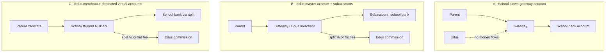

# Edus — Payment Collection Options (Nigeria) — Research & Recommendation

> **Updated 18 Oct 2026:** the accepted parent-paid processing charge is now
> **₦200 handling**, with the **transfer total capped at ₦500**; card fees are
> shown separately. The ₦400 figures below are the earlier decision and are kept
> for history. See `SUBSCRIPTION-AND-TERM-REGISTRATION.md` §6 for the current rule.
>
> **Decided in discussion 23 Oct 2026 (not built):** **term-fee** online payments move to
> a **flat ₦650 transfer charge** — Paystack takes its fee out of it, the rest is Edus
> revenue, and the school still nets its full fee. The **application fee** (paid before
> the form) keeps standard checkout with Paystack's fee passed through **then + ₦350**.
> The ₦200/₦500 rule above is what the code does today. See `VIRTUAL-ACCOUNTS-DESIGN.md`
> §8 and §9.


> **Status:** � DIRECTION AGREED 25 Sep 2026 — see §8. Provider integration not yet built.> 🔴 **OPEN ITEMS TO CONFIRM BEFORE THE FINAL DECISION → §10.** The mechanism is now identified
> (**Pay with Transfer** — a temporary account number per payment, explained in
> `PAYMENT-ARCHITECTURE.md` §7). What remains is confirming the **charge** and two **deal-breakers**.> **Scope:** how Edus collects money **on behalf of schools** — application/form fees, school fees
> and other school income. Edus' own subscription billing is a different (already-built) flow.
> **Rates checked:** 24 September 2026, from the providers' own pricing/docs pages (sources at the end).
> ⚠️ Provider pricing changes. Re-verify every figure before go-live.

---

## 1. What we already have (baseline)

Edus today is **offline-collection first**:

| Piece | Where |
|---|---|
| Bank-transfer **slip** generation with a reference code | `PaymentController` → `app_tenant_payment_slip` |
| Parent uploads **proof of payment** | `PaymentController::uploadProof` → `%proofs_directory%` |
| Bursar **verifies** the reference and confirms with one click | `app_tenant_payment_verify` |
| Automatic SMS to the parent on confirmation | `NotificationService::sendSms()` |
| Cash payments + walk-in store receipts | `PaymentController`, `StoreSalesController` |
| Wallet credit top-ups with proof approval | `WalletController`, landlord `SubscriptionController` |

So "offline" is not a compromise — it is the existing, working product. Anything online we add is an
**acceleration** of the same ledger, not a replacement.

---

## 2. The school's choice: two methods only (deliberate)

We deliberately expose **only two options** (plus "both"), so every school knows exactly which
mechanism it is running. This is already implemented on the tenant `School` entity (`school_settings`):

```php
School::PAYMENT_OFFLINE = 'offline'; // parent transfers to the school's bank account + uploads proof
School::PAYMENT_ONLINE  = 'online';  // parent pays through the payment gateway
School::PAYMENT_BOTH    = 'both';    // school accepts either
$school->getPaymentMethod();         // default: 'offline'
```

| Method | Parent experience | School experience | Cost to school |
|---|---|---|---|
| **Offline** | Slip + transfer → upload proof → wait for confirmation | Bursar verifies manually | Bank charges only (usually ₦0–₦50/transfer) |
| **Online** | Pay by card or transfer on the page → instant confirmation | Nothing to verify — auto-reconciled | Gateway % (see §3) |
| **Both** | Parent picks | Bursar only verifies the offline ones | Gateway % on the online share only |

Small schools with a handful of payments/day should stay **offline** (zero cost, familiar).
Large schools (500+ students, "massive number of students" in your words) should use **online** so
the bursary is not the bottleneck — that is exactly the problem this module removes.

---

## 3. Provider comparison (verified 24 Sep 2026)

### 3.1 Collection fees

| Provider | Local card / USSD | Bank transfer & transfer-to-virtual-account | International card | Notes |
|---|---|---|---|---|
| **Paystack** | 1.5% + ₦100 (₦100 waived under ₦2,500), cap **₦2,000** | **Dedicated Virtual Account: 1% capped ₦300** | 3.9% + ₦100 | Settlement T+1 |
| **Monnify** | 1.5%, cap ₦2,000 | 1.5% cap ₦2,000 **or ₦500 flat** | 4% | **Same-day settlement (by 10pm) + 3 express settlements/day** |
| **Flutterwave** | **2%** (1.4% transaction + 0.6% platform) | 2% | 4.8% | Settlement next day |
| **Paystack transfers out** | — | ₦10 (≤ ₦5,000) · ₦25 (₦5,001–50,000) · ₦50 (> ₦50,000) | — | Payout only |
| **Monnify payouts** | — | ₦10 (< ₦10,000) · ₦20 (≥ ₦10,000) · ₦40 (≥ ₦50,000) | — | Payout only |

**VAT:** all three quote fees **VAT-exclusive** — add 7.5% (Flutterwave states this explicitly).
Monnify: no setup fee, no monthly fee. Paystack: no integration/maintenance fee, T+1 settlement,
volume discounts negotiable.

### 3.2 What actually matters for a **small** application form fee

The form fee is small (typical ₦2,000–₦10,000), so a flat ₦100 kills it. Costs per payment:

| Amount collected | Card (Paystack, 1.5%+₦100) | Virtual-account transfer (Paystack DVA 1%, cap ₦300) | Card (Flutterwave 2%) |
|---|---|---|---|
| ₦2,000 | ₦30 *(₦100 waived)* | **₦20** | ₦40 |
| ₦5,000 | ₦75 *(₦100 waived)* | **₦50** | ₦100 |
| ₦20,000 | ₦400 | **₦200** | ₦400 |
| ₦50,000 | ₦850 | **₦300 (cap)** | ₦1,000 |
| ₦150,000 | ₦2,000 (cap) | **₦300 (cap)** | ₦2,000 (cap) |

➡️ **Transfers into a dedicated virtual account are the cheapest online channel at every size**,
and they are also the *only* channel that reconciles itself (the account number identifies the payer).
Cards remain useful as a fallback for parents without a functioning transfer app.

---

## 4. Where does the money land? (the "school account" question)

This is the decision that matters more than the rate. Three architectures:



| | A · School's own account | B · Master + subaccount split | C · Master + dedicated virtual accounts |
|---|---|---|---|
| Effort to onboard a school | School must open a gateway account and hand us API keys | We create a subaccount (school's bank details + percentage/flat fee) | Same as B, plus virtual-account creation |
| Money path | Parent → gateway → **school's bank** (Edus never holds funds) | Parent → Edus merchant → split to school's bank + Edus | Parent → NUBAN → split to school's bank + Edus |
| Edus commission | Must bill separately (e.g. from the wallet) | **Automatic** (Paystack `percentage_charge` or `transaction_charge` flat) | **Automatic** |
| Compliance burden on Edus | Lowest — we are a tool | Medium — we become a merchant of record and carry chargeback/KYC duties | Medium–high (CBN/NDPR, KYC per school, refunds) |
| Reconciliation | Per-school keys, per-school webhooks | Central webhooks, everything in one place | **Best** — the NUBAN itself identifies the payer/school |
| Cost per ₦50k | ~₦300–850 (school pays) | ~₦300 (DVA) + split | ~₦300 (DVA) + split |
| Paystack specifics | — | `POST /subaccount` with `percentage_charge`, or `transaction_charge` flat fee, `bearer` option | DVA 1% cap ₦300, and a subaccount **can be attached to the virtual account itself** (`/dedicated_account/split`), so each transfer splits automatically |
| Monnify specifics | — | Sub-accounts / splits, T+0 settlement | Reserved accounts (per school or per student) — strongest daily-settlement story |

### Recommendation

**Phase 1 (now):** keep **offline** as the default and ship the application module with offline
payment + proof upload. Zero new compliance, works for every school on day one, and lets us learn
the real volume per school.

**Phase 2 (when a school asks for online):** implement **model C on Paystack** —
Edus master account, one **subaccount per school** (school's bank account + Edus commission), and
**dedicated virtual accounts** for payment. Reasons:
- 1% capped at ₦300 is the cheapest verified rate in this comparison;
- the subaccount can be attached **to the virtual account**, so the split happens automatically on
  every transfer — no manual reconciliation, no invoicing the school;
- card collection is still available on the same integration for parents who prefer it.

**Phase 2 alternative:** **Monnify** if **same-day settlement** matters more to schools than the
per-transaction cost (T+0 by 10pm + 3 express settlements/day vs Paystack T+1), and if a reserved
NUBAN **per student** is attractive (it makes fee reconciliation near-perfect). Note Monnify's
transfer rate (1.5% cap ₦2,000) is materially higher than Paystack's DVA rate (1% cap ₦300).

**Never** model A for our core revenue: it forces us to invoice schools separately for commission.

---

## 5. What we would build (model C)

| Piece | Detail |
|---|---|
| `School` payment config | ✅ already added: `paymentMethod` (`offline`/`online`/`both`) |
| `SchoolPaymentAccount` (new entity) | provider, `subaccount_code`, bank name/account, `percentage_charge`/flat fee, virtual account number, onboarding state. **Gateway secret keys must be encrypted at rest** (sodium) if we ever use model A. |
| `PaymentGatewayInterface` | `initialize()`, `verify(reference)`, `createSubaccount()`, `createVirtualAccount()`, `handleWebhook()`. Adapters: `PaystackGateway`, `MonnifyGateway`. |
| Webhook controller | `POST /webhooks/{provider}` — **no CSRF, no session, IP/signature verified**, idempotent, stores the raw payload, then allocates the money to the right invoice/payment. |
| Reconciliation rules | provider reference **unique** in DB; `charge.success` → find by reference or by virtual-account number → apply to `Invoice` → create `Payment` (same entity the manual flow uses) → SMS the parent. Over/underpayment → leave as credit and flag for the bursar. |
| Requery fallback | webhooks get lost; Paystack exposes a requery endpoint (rate-limited to once per 10 min per account) and the bursar's dashboard should offer a **"Check for new transfers"** button. |
| Application-fee gate | `Application.feeStatus` already exists: `unpaid → awaiting_confirmation (offline proof) → paid`, or `paid` instantly on an online payment webhook. Only `submitted` applications whose fee is settled become reviewable. |
| Fee bearer | **Answered — the parent pays** (§8, P2). A gross-up so the school still nets its full fee; see §8.1. |

---

## 6. Open questions

> ⚠️ **Partially answered on 25 Sep 2026 — see §8 for the decisions and for the questions that
> are still genuinely open (P4 and P6 are the ones that block code).**

| # | Question | Options | My recommendation |
|---|---|---|---|
| P1 | Which provider first? | Paystack · Monnify · Flutterwave | **Paystack** (cheapest DVA + splits), Monnify second if T+0 settlement is demanded |
| P2 | Who pays the transaction fee? | (a) school absorbs (b) parent pays a processing fee (c) split | **(a) school absorbs** — simplest, and it removes a support-script nightmare; revisit at volume |
| P3 | Commission model for Edus | (a) percentage, e.g. 0.5–1% (b) flat ₦ per payment (c) bundled in subscription | **(b) flat per successful online payment**, e.g. ₦20–₦50 — predictable, and does not shrink with inflation like a % of a small form fee |
| P4 | One virtual account per **school** or per **student**? | (a) school (b) student | **(b) per student for fees** (auto-reconciles per child) + (a) for application forms; both are the same API |
| P5 | Do we hold school funds at all? | (a) no (split immediately) (b) yes, as wallet | **(a) never hold funds** — regulatory exposure with no upside |
| P6 | Which schools see "online" at launch? | all · invite only | **Invite only**, after one pilot school completes a full term |
| P7 | Offline verification SLA | bursar-confirmed, anytime | Show the parent "usually confirmed within 24 hours" and SMS them on confirmation |

---

## 7. Sources (accessed 24 September 2026)

- Paystack — Pricing (Nigeria): https://paystack.com/pricing
  *(local 1.5% + ₦100, cap ₦2,000, ₦100 waived under ₦2,500; international 3.9% + ₦100;
  Dedicated Virtual Accounts 1% capped ₦300; transfer fees ₦10/₦25/₦50; T+1 settlement)*
- Paystack — Dedicated Virtual Accounts: https://paystack.com/docs/payments/dedicated-virtual-accounts/
  *(1,000-account default limit; `charge.success` webhook; requery rate-limited to once per 10 min;
  subaccount/split-code can be attached to the virtual account; national KYC/validation rules)*
- Paystack — Split Payments: https://paystack.com/docs/payments/split-payments/
  *(`percentage_charge`, flat `transaction_charge`, `bearer: subaccount`; documented use case
  "separate school fees… tuition, accommodation, excursion")*
- Monnify — Pricing: https://monnify.com/pricing
  *(bank transfer/direct debit 1.5% cap ₦2,000 or ₦500 flat; cards/USSD 1.5% cap ₦2,000;
  international 4%; cash 4%; payouts ₦10/₦20/₦40; same-day settlement by 10pm + 3 express
  settlements; VAT-exclusive; no setup or monthly fees; CBN-licensed, PCI-DSS L1, NDPR)*
- Flutterwave — Pricing (Nigeria): https://flutterwave.com/ng/pricing
  *(2% local = 1.4% + 0.6% platform; 4.8% international; transfers ₦10/₦25/₦50; next-day
  settlement; 7.5% VAT on fees; bearer of charge configurable in dashboard)*

---

## 8. Decisions — answered 25 September 2026

Recorded from the product owner. Where a decision **reverses** my earlier recommendation in §6,
that is called out explicitly — the reversal is deliberate, not an oversight.

| # | Question | Decision |
|---|---|---|
| **P1** | Which provider first? | **Paystack**, confirmed. Structure: **Edus holds ONE Paystack account**, each school is a **subaccount** (just their bank details + our fee — *not* a Paystack account, no keys, no KYC), and a **dedicated virtual account** is attached to it with the split. A school's entire onboarding is *"send us your bank account number"*. Monnify stays the fallback only if a school demands same-day (T+0) settlement. Full explanation: **`PAYMENT-ARCHITECTURE.md` §1**. |
| **P2** | Who pays the transaction fee? | **The parent.** ⚠️ *Reverses my §6 recommendation of "school absorbs".* The school must still receive its **full** fee, so the parent pays `fee + processing fee`. See §8.1 — this needs a gross-up, not a flat add-on. |
| **P3** | Edus commission model | **Per-student subscription (existing) + a share of the transaction charge.** ⚠️ *Reverses my §6 recommendation of a flat ₦ per payment.* Edus earns more as the schools transact more, and it funds deeper features for schools and parents. |
| **P4** | One virtual account per school, or per student? | ✅ **ANSWERED — one DVA per SCHOOL.** ⚠️ *Corrects §8.2, which recommended per-parent.* The 1,000-account limit sits on **Edus'** account across **all** schools, so per-parent would cap the entire platform at 1,000 families and per-student at roughly one school. Per-school makes the limit scale with *our* business: **1,000 schools.** Reconciliation then uses the **unique-amount (kobo) trick** + sender name — see `PAYMENT-ARCHITECTURE.md` §2 and §3. |
| **P5** | Do we hold school or parent funds? | **Never.** Explicitly reinforced: **prepaid parent wallets/deposits are REJECTED.** A parent topping up a balance would let cash accumulate on our books, and the owner identified the concrete abuse vector — *"somebody will just be incrementing the amount … by siphoning the money"* (money passing through a parent account to launder or to hide source). Splits settle straight to the school's bank; **Edus is never a custodian of anyone's money.** |
| **P6** | Which schools see "online" at launch? | 🟡 **Recommending invite-only pilot** — unchanged, awaiting confirmation. |
| **P7** | Offline verification SLA | **Offline stays available** (the school chooses `offline` · `online` · `both`) and is still a first-class path — but the strategy is **online-first**, because manual receipt-checking is exactly the bottleneck that does not scale. The school's time is the thing we are buying back. |

### Why online-first, in the owner's words

The problem being solved is not the fee itself, it is **the school's time and the parent's risk**:

> "...without having them send into their school through WhatsApp or some other … maybe they have to
> go to the school, maybe before then admission is closed, or maybe there are some failure, maybe the
> child is not allowed to sit for examination"

So: pay in real time, get confirmed in real time, **no manual verification in the loop**, no
WhatsApp receipts, no trip to the school, no "we didn't see your transfer" dispute.

### 8.1 The gross-up (P2) — the part that is easy to get wrong

**Two versions were given, and they differ by exactly the VAT — one line to confirm:**

| Model | Rule | At Paystack's cap | Parent pays on a ₦5,000 fee |
|---|---|---|---|
| **A — "add ₦100"** *(your words: "if the charge is ₦300 we add ₦100")* | `charge × 1.075 + ₦100` | ₦322.50 + ₦100 = **₦422.50** | ₦5,000 + ₦153.75 |
| **B — "make it ₦400"** *(your earlier ceiling)* | `charge × 1.075 + ₦77.50` | **₦400.00** | ₦5,000 + ₦131.25 |

The ₦22.50 gap between them is precisely the 7.5% VAT on the ₦300 cap — that is the whole
confusion, and it is why the VAT question mattered. **Model A is recommended**: a round ₦100 margin is
far easier to explain and defend, and ₦422.50 is still below the convenience fees parents already pay
elsewhere. Model B honours the hard ₦400 ceiling.

$$\text{processing} = \min(1\% \times \text{gross},\; 300) \times 1.075 + \text{margin}$$

| Fee | Gateway (incl. VAT)* | Parent pays (A) | Parent pays (B) | School receives |
|---|---|---|---|---|
| ₦2,000 | ₦21.50 | ₦2,121.50 | ₦2,099.00 | ₦2,000 |
| ₦5,000 | ₦53.75 | ₦5,153.75 | ₦5,131.25 | ₦5,000 |
| ₦20,000 | ₦215.00 | ₦20,315.00 | ₦20,292.50 | ₦20,000 |
| ₦30,000+ | ₦322.50 (cap) | ₦30,422.50 | ₦30,400.00 | ₦30,000 |

\* *Computed on the fee for readability. Paystack actually charges on the gross, which costs ~₦1.40
more per transaction — hence the "round up to the nearest ₦1" rule in `PAYMENT-ARCHITECTURE.md` §4.1.*

So the parent transfers **`fee + processing`** and the school's bank receives its **full fee**, because
the split is configured on the gross amount.

*Rejected:* a flat processing fee on every application regardless of size — on a ₦2,000 form fee that
is a ~20% surcharge, which parents notice and resent.

⚠️ **Also confirm with an accountant:** our own margin may itself attract 7.5% VAT (Edus is supplying a
service). If so, add ₦7.50 on a ₦100 margin. See `PAYMENT-ARCHITECTURE.md` §4.

⚠️ **Three consequences to design for, because parents will not do arithmetic:**

1. **Do NOT round the amount — the kobo is the matcher.** With one shared account per school, the
   unique kobo suffix is the *only* thing that identifies which application a transfer belongs to
   (`PAYMENT-ARCHITECTURE.md` §3.1). Show the exact figure, including kobo, and say **"transfer this
   exact amount"**. Rounding to a tidy number would destroy reconciliation — so the earlier "round to
   the nearest ₦50" advice in this section is **withdrawn**.
2. **Transfers are typed by humans.** A parent *will* send exactly ₦5,000. The webhook must treat
   `paid >= fee - tolerance` as **OK and flag the small shortfall** rather than rejecting the
   payment — never leave a parent unpaid-but-paid.
3. **Card is the fallback** for parents whose transfer app adds its own fee. Allowing card-with-surcharge
   on the same page avoids an all-or-nothing funnel.

⚠️ **Paystack DVA limit:** 1,000 virtual accounts by default — a limit increase must be requested
before a 1,000+ student school onboards (relevant to P4).

### 8.2 What pins P4 down

Ask: *when a payment arrives, how do we know what it is for?*

| Option | Build cost | Reconciliation |
|---|---|---|
| (a) **One NUBAN per school** + parent enters a reference | Lowest | Weakest — needs the reference typed correctly |
| (b) **One NUBAN per student** | Highest (1,000 default cap!) | **Perfect** — the account identifies the child |
| (c) **Per application**: reuse (a) at the school level and match on the grossed-up amount + reference | Medium | Good enough for a one-off form fee |

**Recommendation:** for the **application fee**, (c) — the amount + reference is enough, and it
avoids consuming the 1,000-account allowance before the school has paid us anything. Reserve (b) for
**termly school fees**, where per-child matching is worth much more.

---

## 9. Dedicated Virtual Accounts — how they actually work

> Verified against Paystack's own documentation on **25 Sep 2026**, because "virtual account" is easy
> to say and full of constraints that are not obvious until you build on it. Re-verify before go-live.

### 9.1 The experience we are buying

1. The parent finishes the application and taps **Pay ₦5,131.25**.
2. We already hold a **DVA for that parent** — a real 10-digit NUBAN in a Nigerian bank.
3. We show the account number, the exact amount, and "transfer from any bank app".
4. They transfer from their normal banking app and get an ordinary transfer receipt.
5. Paystack calls our webhook: **`charge.success`**, with `channel: "dedicated_nuban"`, plus the
   payer's **name** and **bank account number**.
6. We match the payment to the parent **from the account number itself** — no reference to type, no
   "who sent this?" — settle the fee, submit the application, hand back the reference number.
7. The money has **already been split** to the school's bank account by the subaccount attached to
   the virtual account. **Edus never holds the funds.**

That is the whole point: **the account number IS the identifier**, so nobody at the school has to
check anything. It is also why the parent-wallet idea was rejected (§8, P5) — a wallet would put us
in the middle of the money.

### 9.2 The constraints (all real, all verified)

| Constraint | Detail | Impact |
|---|---|---|
| **Go-live is required** | DVAs are available only to **registered Nigerian/Ghanaian businesses that completed Paystack's go-live process** | 🔴 Confirm on your account **before** we build |
| **One DVA per customer** | Created against a Paystack *customer* (`email`, `first_name`, `last_name`, `phone`) | It is naturally **one per parent**, not per application |
| **Identity validation** | Required **only** for the categories *Betting*, *Financial services* and *General services* — then **every customer must be BVN/bank-validated** before an account can be generated | 🔴 **If Edus is classed as "General services", every parent would have to supply a BVN just to apply.** Confirm our category first — this single fact changes the whole onboarding design |
| **Account limit** | **1,000 DVAs by default**, increased on request to support | Fine for one-per-parent; **fatal** for one-per-application |
| **Account name** | Displays as `Product Name / Customer Name` — e.g. `EDUS / IBRAHIM SANUSI`. A custom-naming feature exists but must be requested | ⚠️ The parent sees **Edus**, not their school. Request the naming feature so the school's name is visible — parents trust a name they recognise |
| **"Instant" is approximate** | Paystack: the webhook "typically happens within a few minutes" | Say *"confirmed automatically, usually within seconds"*. Use **requery** as the fallback — **rate-limited to once per 10 minutes** |
| **Split** | A subaccount **or** split code can be attached at creation **or later** (`POST /dedicated_account/split`) | The school's share settles to the school's own bank automatically |
| **Two flows** | *Multi-step* (create customer → validate → create DVA) or *single-step* (`POST /dedicated_account/assign`) | Single-step is less code; multi-step gives more control over retries |

### 9.3 Events we must handle

| Event | Meaning |
|---|---|
| **`charge.success`** | Money arrived — the one that actually matters |
| `dedicatedaccount.assign.success` / `dedicatedaccount.assign.failed` | The virtual account was created (or wasn't) |
| `customeridentification.success` / `customeridentification.failed` | BVN/bank validation result (category-dependent) |

### 9.4 We can build and test this without real money

Paystack supports DVAs in **test mode**: pass `preferred_bank: "test-bank"` and simulate the incoming
transfer with Paystack's **demo bank** app. So the entire chain — DVA creation → simulated transfer →
webhook → fee settled → application submitted — can be built and verified before a single naira
moves. ✅ **This is not blocked on anything.**

### 9.5 Revised answer to P4 — ⚠️ SUPERSEDED (see §10 and `PAYMENT-ARCHITECTURE.md` §7)

Because a DVA is per *customer*, "per application" is fighting the API. The real choice:

| Option | Reconciliation | Account budget | Verdict |
|---|---|---|---|
| **One DVA per parent** | Perfect on **identity**; the *application* is matched by the exact expected amount, else the oldest unpaid draft | ~1 per family — a 1,000-student school has far fewer than 1,000 families | ✅ **Recommended** — the experience asked for, at the lowest account cost |
| One DVA per application | Perfect on both axes | Wasted on every abandoned draft | ❌ |
| One shared school account | Needs a typed reference that must survive the bank's narration field | 1 | ❌ reintroduces the failure mode we are removing |

**Ambiguity rule for one-per-parent:** if a parent has more than one unpaid application, apply the
payment to whichever **expected amount matches exactly**; otherwise to the **oldest unpaid** draft —
and show the parent which child it went to. The bursar can reassign in Phase 4.

---

## 10. 🔴 Open items — to confirm before the final decision

> **The mechanism is now identified:** Paystack's **Pay with Transfer** issues a *temporary* account
> number tied to one transaction, destroyed as soon as the payment lands or the timer runs out.
> Full explanation: **`PAYMENT-ARCHITECTURE.md` §7**. What follows is only what is still unanswered.

### 10.1 Are we still "chargeless"? **No — and we never were.**

Paystack charges a fee on **every** transaction. There is no free channel, for DVAs or for Pay with
Transfer. The only open question is **which rate applies to Pay with Transfer**, and the pricing page
does not say:

| Candidate rate | On a ₦5,000 form fee | On a ₦50,000 fee |
|---|---|---|
| **1% capped ₦300** — ✅ confirmed for DVAs | ₦53.75 incl. VAT | ₦322.50 *(cap)* |
| **1.5% + ₦100, capped ₦2,000** — the standard local rate | ₦188.13 incl. VAT | ₦913.75 |
| Difference | **3.5×** | **2.8×** |

This matters because **the parent pays it**, so it decides the surcharge we show them (≈3% vs ≈5.8%
on a ₦5,000 fee) — and whether our ₦100 margin survives at all.

- [ ] **CONFIRM: what rate does Paystack bill for Pay with Transfer?** ← *the single most important number*

### 10.2 ✅ Decided — and the one technical question that remains

**✅ BVN: NOT required. Settled.** The owner's reasoning is decisive: *"parents will not hand over their
BVN simply because they want to make payment … they are not owning an account that they can keep."*
Paystack's validation rule exists for **dedicated virtual accounts** — where an account is created **in
the customer's name and kept permanently**, so that customer must be identified. A Pay-with-Transfer
account is **temporary, tied to one transaction, and never named after the parent**. There is no customer
to validate.

> 🔑 **This is the strongest single argument for Pay with Transfer over per-parent DVAs.** Per-parent
> DVAs would mean **every parent** undergoing identity validation — an unacceptable barrier to applying
> for a school place. **PwT avoids that by design.**

**🚨 The one question still worth putting to Paystack — it is technical, not a business decision:**

- [ ] **Can a subaccount or split code be attached to a `POST /charge` bank transfer?**
  The **business model is already settled**: the school receives its fee; Paystack and Edus take the
  charges. What is unknown is whether Paystack's *API* allows that split to be attached to **this
  endpoint**. If it does not, the money lands in Edus' account and we would have to pay schools out
  ourselves — breaking *"we never hold funds"*. **If it fails, PwT is out and per-school DVAs are the
  fallback — with no change to the flow design** (`PAYMENT-FLOW-DESIGN.md` §9).
- [ ] **Is Pay with Transfer available in test mode?** DVAs test with `preferred_bank: "test-bank"` plus
  the demo bank app; we need the PwT equivalent to demonstrate the flow before go-live.

### 10.3 ✅ Limits and scale — resolved in principle

**✅ The 1,000-account ceiling no longer applies.** Temporary accounts are not the DVA pool, so scale is
unbounded by that limit: 10 schools × 500 parents = 5,000 payments, **zero permanent accounts**.
Two small things to check at go-live rather than to decide:

- [ ] **Rate limit** on creating temporary accounts — behaviour if thousands of parents pay in one hour.
- [ ] **Minimum / maximum amount** per Pay with Transfer charge.
- [ ] **Volume discount** at our projected throughput — Paystack confirms these exist for high volume.
- [ ] *Optional:* a **DVA limit increase** is no longer needed, but it costs nothing to ask.

### 10.4 Housekeeping

- [ ] **Go-live status** of our Paystack account — required for DVAs; confirm whether PwT needs it too.
- [ ] **Account naming** — request the custom naming feature so the parent sees the **school's** name,
  not `EDUS / PARENT NAME`.

### 10.5 ✅ Our own decisions — now made

- **✅ Charges capped at ₦400, model reconciled.** `charges = min(paystackFee + ₦100, ₦400)`. Below
  ~₦30,000 Edus keeps ₦100; at and above it, the cap pulls Edus' margin to ₦77.50 so the parent is never
  charged more than ₦400. Full table: **`PAYMENT-FLOW-DESIGN.md` §2**.
  ⚠️ **This cap is only achievable if PwT bills at 1% capped ₦300.** At 1.5% + ₦100, Paystack alone
  passes ₦400 on any fee above **₦20,000**, and the cap becomes impossible (see §10.1).
- **✅ Temporary account validity: Paystack's default (8 hours).** Pass `account_expires_at: null`.
- [ ] **VAT on our own ₦100 margin** — accountant's call (§8.1).
- [ ] **Invite-only pilot** for the online path at launch (§8, P6).
- [ ] *Flag, not a blocker:* a flat ₦100 margin is **6.1% of a ₦2,000 fee**. If schools charge small form
  fees, consider a proportional margin below ~₦5,000.

### 10.6 Not blocked — work we can start immediately

> 📐 **The full flow design is in `PAYMENT-FLOW-DESIGN.md`** — parent journey, state machine, entity,
> routes, gateway interface, webhook and the edge-case matrix. Phases A–E, G and H do not depend on
> any answer below.

The flow is provider-agnostic, so this can be built now and the Paystack adapter dropped in later:

1. **`PaymentIntent` entity** — charge reference, expected amount, temporary account number, expiry,
   status — plus the **hard gate**: an application cannot become `submitted` without a confirmed intent.
2. **The parent-facing "pay" step** — account number, exact amount, a live countdown, "transfer from any
   bank app", and the auto-flip to *submitted* the moment payment lands.
3. **`PaymentGatewayInterface` + a `FakeGateway`** — the whole flow demonstrable and testable today.
4. **The webhook endpoint** — signature verification, idempotency, reconciliation queued through
   `messenger_messages` (already set up on every tenant).
5. **The in-app online-vs-offline notice** for the school settings screen.

