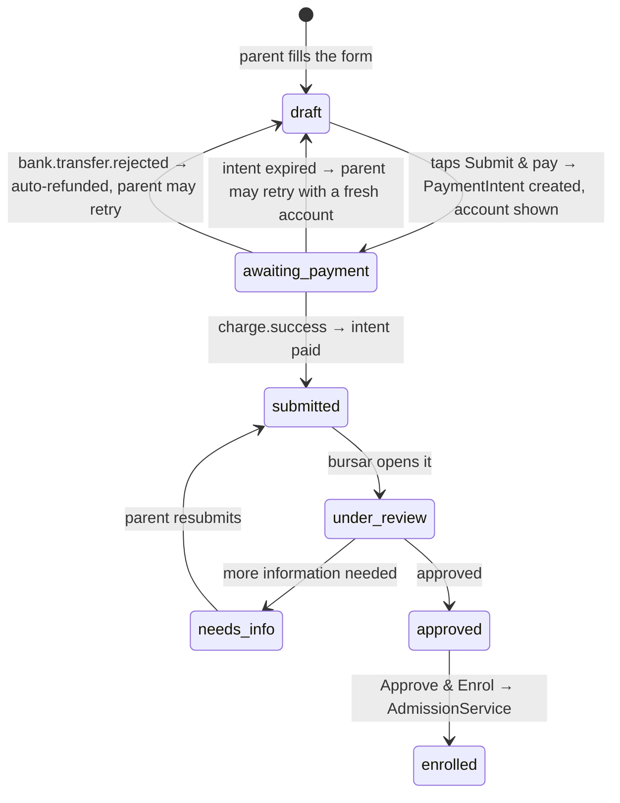

# Edus — Payment flow design (application fee)

> **Status:** 🟡 DESIGN — for review before implementation.
> **Updated 18 Oct 2026:** the accepted parent-paid processing charge is now
> **₦200 handling**, with the **transfer total capped at ₦500**; card fees are
> shown separately. The ₦400 figures below are the earlier decision and are kept
> for history. See `SUBSCRIPTION-AND-TERM-REGISTRATION.md` §6 for the current rule.
> **Implements:** the decisions in `PAYMENT-COLLECTION.md` §8 and the mechanism in
> `PAYMENT-ARCHITECTURE.md` §7 (Paystack **Pay with Transfer** — a temporary account per payment).
> ⚠️ Two Paystack facts are still unconfirmed (§9). The design isolates them so the build is not blocked.

---

## 1. What this flow must achieve

| Requirement | Source |
|---|---|
| A parent **cannot submit an application without paying** — no reference, no "submitted" | §8 P2 / hard gate |
| The school **never verifies anything by hand** on the online path | the core motivation |
| The parent pays an **extra charge**, **capped at ₦400** | owner, 25 Sep |
| The school receives its **full fee**, untouched | owner |
| **Edus never holds funds** — the split settles straight to the school's bank | §8 P5 |
| **No BVN** — the parent is not opening an account, so no identity validation | owner, 25 Sep |
| The temporary account **dies on payment or on expiry** (Paystack default = 8 hours) | owner, 25 Sep |
| Offline stays available as a school-selectable alternative | §8 P7 |

---

## 2. The fee formula (agreed shape)

```text
paystackFee = min(gross × 1%, ₦300) × 1.075      // the 7.5% VAT applies to the charge, not the money
charges     = min(paystackFee + ₦100, ₦400)       // Edus margin ₦100, hard cap ₦400
total       = fee + charges                        // what the parent transfers
```

| Form fee | Paystack (incl. VAT) | Edus | **Charges** | **Parent transfers** | Surcharge |
|---|---|---|---|---|---|
| ₦2,000 | ₦21.50 | ₦100.00 | ₦121.50 | **₦2,121.50** | 6.1% |
| ₦5,000 | ₦53.75 | ₦100.00 | ₦153.75 | **₦5,153.75** | 3.1% |
| ₦10,000 | ₦107.50 | ₦100.00 | ₦207.50 | **₦10,207.50** | 2.1% |
| ₦20,000 | ₦215.00 | ₦100.00 | ₦315.00 | **₦20,315.00** | 1.6% |
| ₦30,000 | ₦322.50 | ₦77.50 | **₦400.00** *(cap bites)* | **₦30,400.00** | 1.3% |
| ₦50,000+ | ₦322.50 | ₦77.50 | **₦400.00** *(cap)* | **₦50,400.00** | 0.8% |

**Above ~₦30,000 the cap does the work:** Edus' margin shrinks from ₦100 to ₦77.50 so the parent is
never charged more than ₦400.

> ⚠️ **The ₦400 cap is CONDITIONAL on Pay with Transfer billing at the DVA rate** (1% capped ₦300).
> If it bills at the standard local rate (**1.5% + ₦100, capped ₦2,000**), Paystack's own charge passes
> ₦400 on any fee above **₦20,000** — so a ₦400 cap becomes **impossible** for larger fees and one of
> three things must give: the cap rises, the school absorbs the excess, or the fee is capped.
> **This is the single number to confirm before go-live** (`PAYMENT-COLLECTION.md` §10.1).
>
> ⚠️ **Small-fee friction:** a ₦100 flat margin is 6.1% of a ₦2,000 fee. Defensible (it is what a bank
> transfer costs anyway), but if schools charge small form fees, consider a proportional margin below
> ~₦5,000. **Owner's call — not blocking.**

---

## 3. The parent journey (mobile-first, because they are on a phone)

1. **Step 5 → "Submit & pay ₦5,153.75"** — one button. The label shows the exact total, so the amount is
   never a surprise.
2. **Payment screen** (one screen, no scrolling needed):
   - **₦5,153.75** in the largest type on the page — the single number that matters.
   - The **account number** with a big **"Copy"** button, and the bank name.
   - A **countdown** — *"This account is valid until 5:14 PM"* (Paystack default, 8 hours).
   - **"Open my bank app"** helper text: *transfer **exactly** this amount from any bank app.*
   - ⚠️ **The biggest UX risk:** a parent transfers the ₦5,000 fee and skips the charge. Paystack will
     **reject and auto-refund** it — recoverable, but it costs the parent trust and time. Mitigation:
     the amount is the page's hero, copy-pasteable, with an explicit *"do not change this amount"* line.
3. **We poll and wait.** The screen refreshes automatically (poll every ~5s, and on tab focus). The
   parent can close the app — nothing is lost, the account stays live.
4. **Payment lands** (seconds) → the screen flips to **"Payment confirmed 🎉"** and shows the
   **reference number** (`APP/2026/0003`) with the timeline entry. The application is now `submitted`
   and visible to the bursar.
5. **Wrong amount / expired / abandoned** → see §7.

**Why this is better than a reference code:** the parent never types a reference, never uploads a
receipt, never waits for a human, and the account number itself carries the identity.

---

## 4. State machine



**Rules**

| Rule | Why |
|---|---|
| A **reference number is only assigned at `submitted`** — never before | the hard gate: nothing reaches the school unpaid |
| `awaiting_payment` applications **never appear in the bursar's queue** | the school's time is the thing we're buying back |
| An expired intent returns the application to **`draft`** — it is fully editable, nothing is lost | the parent keeps their ten minutes of typing |
| Each retry creates a **new intent and a new account number** | Paystack destroys the old one |

---

## 5. Data model

### 5.1 New entity: `PaymentIntent` (table `payment_intent`)

| Column | Notes |
|---|---|
| `id` | |
| `reference` | **our** idempotency key, sent to Paystack as `reference` — unique |
| `providerReference` | Paystack's charge reference, filled on response |
| `providerAccountNumber` | the temporary NUBAN shown to the parent |
| `providerBankName` | e.g. Wema |
| `expectedAmount` | **exactly** what must arrive (kobo-precise) |
| `feeAmount` | the school's share (fee) |
| `chargeAmount` | the parent's charge (fee-bearing — §2) |
| `status` | `pending` · `paid` · `expired` · `rejected` · `failed` |
| `expiresAt` | from Paystack; default 8 hours |
| `paidAt` | |
| `payload` | raw webhook JSON (audit + disputes) |
| `createdAt` / `updatedAt` | |

Relationships: `application` (the gating subject) · `school` (for the split) · `guardian` (who pays) ·
`payment` (the existing `Payment` row created **once paid**, so the ledger stays unified).

### 5.2 Changes to `Application`

Already present: `feeStatus`, `feeAmount`, `feeChannel`, `feeReference`, `feePaidAt`, `feePayment`.
**Add** `paymentIntent` (`OneToOne`, nullable) so the status page can resume the same intent.

---

## 6. Routes & gateway

### 6.1 Routes

| Method | Path | Route name | Purpose |
|---|---|---|---|
| POST | `/parent/applications/{id}/pay` | `app_parent_applications_pay` | Create the intent + show the account screen |
| GET | `/parent/applications/{id}/payment` | `app_parent_applications_payment` | The waiting screen (resumable, survives a reload) |
| GET | `/parent/applications/{id}/payment/status` | `app_parent_applications_payment_status` | **JSON** poll target |
| POST | `/parent/applications/{id}/payment/cancel` | `app_parent_applications_payment_cancel` | Abandon → back to `draft` |
| POST | `/webhooks/paystack` | `app_paystack_webhook` | **No session, no CSRF**, signature-verified |

### 6.2 The gateway interface

```php
interface PaymentGatewayInterface
{
    /** Create a one-off collection with a temporary account. */
    public function startCollection(PaymentIntent $intent, School $school): PaymentIntent;

    /** Re-query when a webhook is late (throttled — provider rate limits apply). */
    public function verify(PaymentIntent $intent): PaymentIntent;

    /** Constant-time webhook signature check. */
    public function verifySignature(Request $request): bool;

    /** Normalise a provider payload into our vocabulary. */
    public function parseWebhook(array $payload): PaymentEvent;
}
```

Adapters: **`PaystackGateway`** (real) and **`FakeGateway`** (dev/test — simulates `charge.success`,
`bank.transfer.rejected` and expiry on demand). The `FakeGateway` is what lets the whole flow be
demonstrated **today**, before the two open Paystack questions are answered.

### 6.3 The session flow starts with a deliberate act

`POST /pay` (not a GET) so a link preview, a refresh, or a browser pre-fetch can never create an intent.
CSRF-protected, ownership-checked, and refused unless the application is `draft` or `awaiting_payment`.

---

## 7. Edge cases — the part that decides whether this feels trustworthy

| Case | What happens | Parent sees |
|---|---|---|
| **Wrong amount** | Paystack fires `bank.transfer.rejected` and **auto-refunds** | *"That transfer wasn't the exact amount and has been refunded to you. Ready to try again?"* + fresh account |
| **Account expired, unpaid** | Intent `expired`, application back to `draft` | *"That payment window closed. Your answers are safe — start the payment again."* |
| **Paid *after* expiry** | Match on `providerReference`; treat as paid if it arrives — **never lose a parent's money** | Confirmed |
| **Double payment for one application** | Second `charge.success` finds the intent already `paid` → record as a **surplus credit**, flag the bursar | *"You've paid twice — the school will refund or credit the extra."* |
| **Webhook arrives twice** (Paystack retries) | `reference` is unique; the handler is idempotent — the second is a no-op | Nothing changes |
| **Webhook never arrives** | Poll path calls `verify()`, throttled; plus a manual **"Check for payment"** button | *"Still checking…"* then confirmed |
| **Parent abandons mid-payment** | After expiry the application returns to `draft`; the draft is untouched | Nothing (drafts are theirs) |
| **Parent closes the app while waiting** | Intent stays live; reopening the application resumes the same account screen | The same account, same countdown |
| **Provider outage** | Intent `failed`; clear retry message; the **offline** path remains available if the school enabled it | *"Payments are temporarily unavailable — you can pay at the school."* |

**Design rule: no path may lose money or silently drop an application.** Every rejection is refunded by
the provider; every expiry returns the parent to a safe, editable state.

---

## 8. The webhook (a real component, not an afterthought)

1. **Verify the signature** (`x-paystack-signature`, HMAC-SHA512 of the raw body with the secret key)
   **in constant time — before parsing anything.**
2. **Respond 200 immediately**, then dispatch reconciliation to the queue
   (`messenger_messages`, already provisioned on every tenant) so slow work never causes a provider retry storm.
3. **Idempotent**: look up by `reference`; if already `paid`, stop.
4. **Store the raw payload** — this is the audit trail for disputes.
5. **Never trust the payload alone** for value: re-verify the amount against `expectedAmount` before
   settling, and confirm the transaction with the provider for anything unusual.
6. At 10 schools × 500 parents, this handler may see **thousands of events**; it must be cheap,
   idempotent and queued. Set an alert if the queue backs up.

---

## 9. Open dependencies (do not block the build)

| # | Item | Why it doesn't block us |
|---|---|---|
| 1 | **Pay with Transfer's fee rate** (1% cap ₦300 vs 1.5% + ₦100) | The fee formula is one function behind config; only the constants change. **But it decides whether the ₦400 cap is achievable** (§2). |
| 2 | **Can a subaccount/split attach to `POST /charge`?** | The split is a *configuration* concern of the adapter. **If it cannot split, PwT is unusable and we fall back to per-school DVAs** — the `PaymentIntent`, the state machine, the webhook and the UI all survive unchanged. |

Both live in `PAYMENT-COLLECTION.md` §10.

---

## 10. Build phases

| Phase | Deliverable |
|---|---|
| **A** | `PaymentIntent` entity + migration on all tenants; `Application.paymentIntent` link |
| **B** | `PaymentGatewayInterface` + `FakeGateway` + the fee calculator (unit-tested against §2's table) |
| **C** | `POST /pay`, the payment screen (account + amount + countdown + copy), the status JSON poll, and the auto-flip to `submitted` with a reference |
| **D** | The hard gate: submission is impossible without a confirmed intent; expired/rejected paths return to `draft` |
| **E** | Webhook controller: signature, idempotency, queue, raw-payload storage |
| **F** | `PaystackGateway` — swap in behind the interface once §9 is answered |
| **G** | The in-app **online vs offline** notice in school settings | 
| **H** | Tests: every row of §7, plus the fee table |

**Phases A–E, G and H are not blocked.** Only **F** waits on Paystack.
