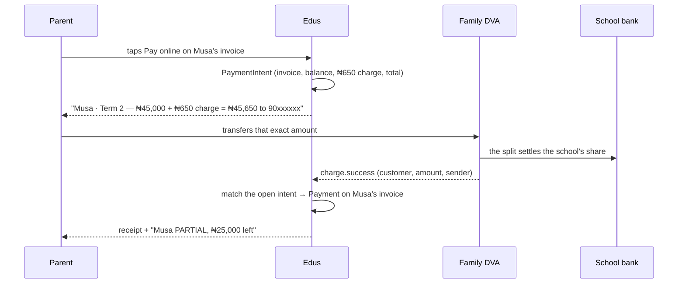
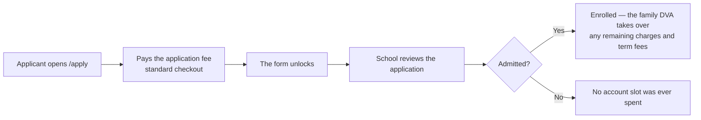
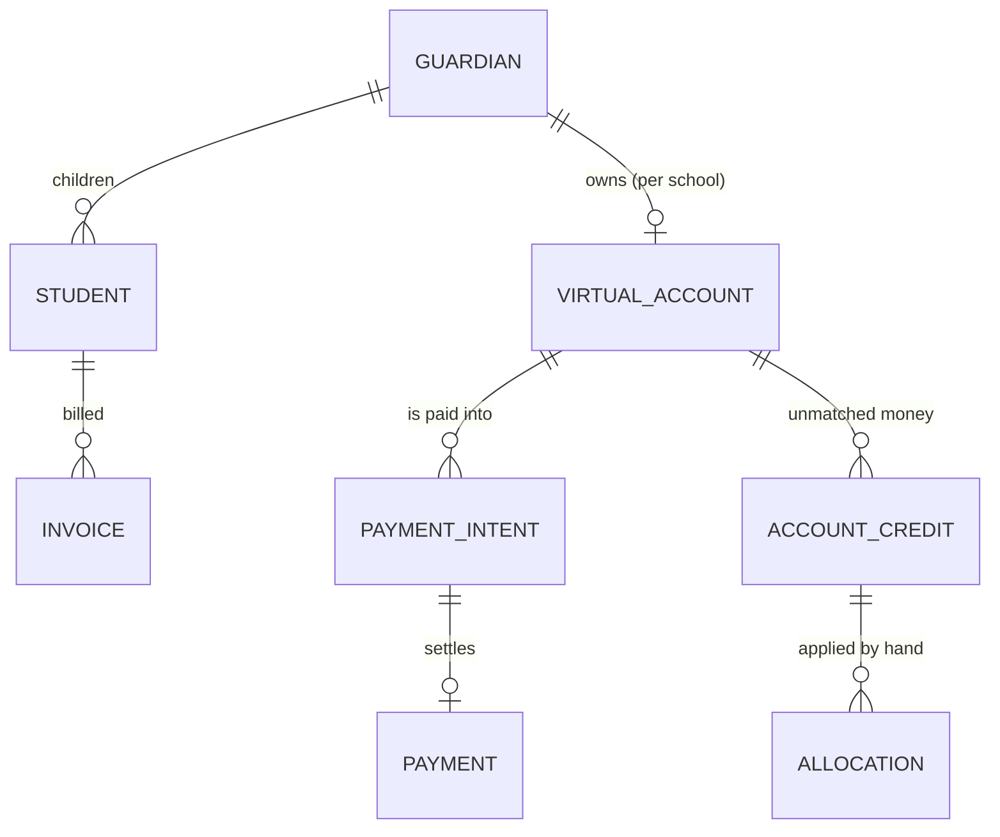

# Dedicated virtual accounts — school fees and the online application fee

> **Status:** 🗣️ **DISCUSSION — nothing built.** This file exists so the account
> model, how a payment reaches the right invoice, and the money are agreed before a
> line of Paystack code is written. Nothing here overrides a decision already recorded
> in `PAYMENT-COLLECTION.md` / `PAYMENT-ARCHITECTURE.md`; where it proposes a change,
> it says so and gives the numbers.
>
> **Asked for by the owner (23 Oct 2026):** a dedicated virtual account for every
> student — resolved to **one per family (guardian), per school** (§4) — linked to the
> school's subaccount; a limit increase once we pass ~1,000 accounts; a **flat ₦650
> transfer charge** on term-fee payments, with a separate **card-rate + ₦350** charge
> for the application fee (paid before the form) taken through standard checkout.
> Questions raised: can the account be **per parent** instead of per student, and how
> do we reconcile **installments for several children under one parent**?
>
> **Read alongside:** `PAYMENT-ARCHITECTURE.md` (accounts, subaccounts, the 1,000
> limit, Pay with Transfer), `PAYMENT-COLLECTION.md` (commercial rules),
> `ONLINE-PAYMENT-AND-APPLICATION-FEE.md` (what already ships), and
> `ProcessingFeeCalculator` (the one place the fee maths lives).

---

## 0. The short answer

| Question | Answer |
|---|---|
| Can a parent have **one dedicated account** for all their children? | **Yes — and it is the better model.** Paystack issues a virtual account to a **customer**, which is the **parent**, not the child. See §4. |
| Can the account be **per student**? | Only if Paystack will open a customer record for a **minor** using the guardian's KYC. A 7-year-old usually has no BVN. **This is the blocker** — ask Paystack before promising it. §4.3 |
| **Must the parent give a BVN or NIN?** | **Only if our Paystack business category requires it.** Betting, Financial services and General services **must** validate (BVN + a bank account in that name); other categories need only email, name and phone. The API takes **BVN, not NIN**. We never store the BVN. §4.5 |
| How do installments across several children reconcile? | **They do not cross children.** Each student has their own invoice and the parent pays **one invoice per transfer**, for the figure the portal shows. Installments are part-payments of *that* invoice. Money that cannot be tied to the chosen invoice is held as a visible **unassigned credit**, never auto-split. §5 |
| How many accounts do we need? | **~1 per family, not per student** — roughly 35% fewer. But 1,000 students is still ~650–700 families, so the limit increase is needed either way. §6 |
| What about a group with several schools? | **One subaccount per school** (Gobarau: four), so **one account per parent per school**. Each school's portal shows only its own number; there is **no cross-school balance**. §4.4 |
| Are these wallets? | **No — payment only.** No balance, no card storage, no payouts, no POS funding. The one credit that can exist is an **unassigned** payment awaiting a bill, with an owner and a deadline. §3.1 |
| What does the parent pay online? | **₦650 on every online payment — part or full**, itemised on the payment screen beside the bill; Paystack takes 1% capped ₦300 + VAT out of it and **the balance is credited to Edus**. The school still nets its full fee. §8, §5.8 |
| **Application fee** (paid before the form) through a DVA? | **No.** Standard checkout instead: Paystack's fee is **passed through** and **₦350 is added after it**, so **Edus nets exactly ₦350**. Applicants may never enrol, and every unused DVA burns an account slot. The DVA starts at enrolment. §9 |

**Decided:** the account owner is the **guardian** (§4), one account per **parent per
school** — four subaccounts for Gobarau (§4.4) — payment is **invoice-by-invoice with
no combined payment** (§5), the accounts are **payment-only, never wallets** (§3.1),
every online payment carries a **₦650 charge, part or full** (§8.4), the parent sees
that charge **on the payment screen** (§5.8), and the **application fee — paid before
the form — uses standard checkout**, Paystack's fee passed through **then + ₦350**
(§9). **Still to decide:** the part-payment minimum (D9) and the ₦100 card waiver
(D11).

---

## 1. What we have today (so we are not designing in the dark)

| Piece | Reality in the code |
|---|---|
| **Money path** | Paystack **hosted checkout**, split to `school_settings.paystack_subaccount_code`. Edus never holds funds (`PAYMENT-ARCHITECTURE.md` §8, P5). |
| **Who pays** | `Guardian` — unique email, optional `User` login, `OneToMany` **students**. One family, many children, already modelled. |
| **Bills** | `Invoice` per student per term with `totalAmount` / `paidAmount` / `status` **UNPAID · PARTIAL · PAID**. Partial payment is already a supported state. |
| **Payments** | `Payment` (amount, method, reference, invoice \| advance) — the ledger. `StudentAdvance` already holds money paid ahead of a bill. |
| **Online attempt** | `PaymentIntent` (reference, purpose `invoice` \| `application_fee`, amount, invoiceAmount, processingFee, provider refs, raw payload). |
| **Fee maths** | `ProcessingFeeCalculator`: transfer/DVA **1% capped ₦300**, VAT 7.5% on that charge, **₦200 handling**, parent charged **max ₦500** — superseded by the flat ₦650 for invoices (§8) and by the card schedule + ₦350 for the application fee (§9). Parent pays, school nets its full fee. |
| **Application fee** | Online since 21 Oct 2026, paid **before** the form, its own `PaymentIntent` purpose. |

So the bank transfer is already automated — what a DVA adds is **identity**: today
the parent is *inferred* from a shared account number plus an amount; with a DVA the
account number **is** the payer.

---

## 2. The proposal, restated plainly

1. Every **family** (guardian) gets a **real NUBAN** they can transfer to from any
   bank app — one per family per school, reused every term.
2. Each **student's invoice is paid separately**: the parent opens one invoice, the
   portal shows one exact figure, and they transfer that figure. Nothing pools
   across children.
3. That NUBAN is attached to the **school's subaccount**, so each transfer splits to
   the school's bank automatically.
4. Two charges, deliberately different: **₦650 flat** on invoice payments, and **Paystack's card rate + ₦350 after it** on the **application fee paid before the form** (§8, §9).
5. We ask Paystack for a limit increase once we approach the account limit.

Everything below is about the two words in bold: **whose** account, and **whose**
money once it lands.

---

## 3. Why the account number matters more than the fee

With the current shared school account, every payment is a **guess** resolved by
amount, sender name and a bursar's queue (`PAYMENT-ARCHITECTURE.md` §3.4). With a
dedicated account:

| Today (shared account) | With a DVA |
|---|---|
| "Someone transferred ₦20,000 — who?" | "The Okonkwo family transferred ₦20,000." |
| Kobo tricks to make amounts unique; ~30 concurrent payments per school before collisions | No collisions — the account identifies the payer |
| Rounding breaks the match | Rounding is just a partial payment |
| Third-party payer (uncle, church) is unidentifiable | Still credits *that family's* account — the sender name is not the key |
| Bursar re-assigns by hand | Bursar only re-allocates **between that family's children**, which is reversible bookkeeping |

That is the real prize: **not the ₦300**, the disappearance of the reconciliation
queue.

### 3.1 Payment-only, by design — what these accounts are **not**

**Owner, 23 Oct 2026:** *"they are just virtual accounts for transfer of their
payment, that's all, nothing else."* Written down as a rule, because every one of
these is the obvious "while we are here" request:

| The account is | The account is **never** |
|---|---|
| A fixed NUBAN a parent transfers *school fees* into | ❌ A **wallet** — no balance to top up, spend or withdraw |
| A way to identify the payer of a specific invoice (§5) | ❌ **Card storage**, saved cards or direct debit |
| Settled automatically to the **school's bank** via its subaccount | ❌ A place Edus holds money (§8, P5 in `PAYMENT-ARCHITECTURE.md`) |
| Reused every term for the same family | ❌ **Payouts** or transfers out of the account |
| | ❌ A **store/pos** funding source, or a deposit for future terms |
| | ❌ A **cross-school balance** shared between a group's schools |

The only thing that even resembles a balance is the **unassigned credit** of §5.5 —
and that is an **exception with an owner and a deadline**, not a feature. Any credit
older than the term is refunded or applied by the bursar, listed on a report. If it
can sit there forever, we have quietly built a wallet and lost the simple story.

---

## 4. Whose account — student, parent, or school?

### 4.1 The three levels, and what each costs

| Model | Accounts needed (1,000 students) | Who is KYC'd | Cross-school sibling | Allocation |
|---|---|---|---|---|
| **Per student** | 1,000 | **The child** — a minor rarely has a BVN or a bank account ⛔ | n/a | None — unambiguous |
| **Per parent (per school)** ✅ | ~650–700 | **The parent** — can be validated when required (§4.5) | Two accounts, one per school — clean | Policy + override (§5) |
| **Per school** (today) | 1 | Edus | n/a | Amount-matching queue ⛔ |

### 4.2 Why per-parent is the right unit

1. **Paystack's virtual account belongs to a *customer*, and the customer is the
   person who pays.** The account is opened against a customer record holding the
   payer's email, name and phone — plus **BVN + a bank account of their own when
   Paystack requires validation** (§4.5). That is the parent.
2. **The money is the family's, not the child's.** A parent paying ₦75,000 for three
   children has not paid "Musa"; they have paid the family's bill. Ownership belongs
   at the family level; allocation is bookkeeping.
3. **It is already the shape of our data.** `Guardian` → many `Student`. The account
   hangs off the guardian and needs no new parent/child concept.
4. **Fewer accounts and fewer KYC events.** One validation per family instead of one
   per child — roughly a third fewer accounts against Paystack's limit, and far less
   personal data in scope under NDPA.
5. **Installments work naturally.** Each invoice is paid in parts, on its own; the
   shared account is only the address the money arrives at (§5.4).

### 4.3 What would break per-student accounts

- **A minor usually has no BVN and no bank account.** Where Paystack requires
  validation (§4.5), that is exactly what it asks for — in the *customer's* name. Even
  where validation is optional, the account is named *"Product / Customer"*, so a
  child's account would carry a name no bank app recognises as the payer's.
- **Twice the accounts**, so the limit increase becomes urgent much sooner.
- **Two payment records for one transfer** if a parent ever pays for siblings in one
  go — which is exactly what parents do.

> **Verdict:** build **one dedicated account per guardian per school**. Keep the
> per-student *view* in the UI — the parent opens "Musa" and sees his bill, then pays
> that bill — but the bank account behind it is the family's.
> If Paystack confirms minor-KYC in writing, per-student can be a later option, not
> a rewrite: the intent-per-invoice flow below is what makes both work.

### 4.4 One parent, two schools — **four subaccounts, four accounts** (decided)

**Owner, 23 Oct 2026:** Gobarau has **four schools** (`gaknursery`, `gakprimary`,
`gakjss`, `gaksss`), so it has **four Paystack subaccounts — one per school** — and a
parent pays into the account belonging to **the school whose site they are on**.

Consequences, accepted:

- A family with a nursery child and a JSS child has **two virtual accounts**. The
  nursery portal shows only the nursery number; the JSS portal shows only the JSS one.
  They are never combined, because the money must split to **different bank
  accounts** (§3.1: no cross-school balance).
- It happens naturally: each school is its own tenant database and its own site, so a
  parent is *already* in one school at a time. No cross-tenant parent view is being
  built.
- A transfer into the wrong school's account still lands **at that school**. It is not
  lost, but it must be moved by hand — the "this was for the other school" request
  that the bursar actions (§7, F5).
- Setup work: each of the four schools needs a **subaccount** (its bank details +
  split) before any parent can be issued an account there.

**One technical unknown:** Paystack customers are keyed on **email**. The same parent
appears in four tenant databases with the same email, so the same *customer* may be
returned for all four schools — which is fine, because a customer can hold several
virtual accounts, each with its own subaccount split. Confirm that creating a customer
for an existing email returns the existing code rather than failing (§11 Q15).

### 4.5 What Paystack actually requires — **verify this before promising it**

From Paystack's DVA documentation and Customer API reference, read **23 Oct 2026**:

| Step | Required | When |
|---|---|---|
| **Create the customer** | `email`; `first_name`, `last_name`, `phone` | Name + phone become **compulsory** when the customer will get a DVA, for the categories **Betting, Financial services, General services** |
| **Validate the customer** | **BVN + a bank account in that name + bank code** | **Only for those three categories.** Other categories may skip it |
| **Create the DVA** | customer + `preferred_bank` (+ optional `subaccount` or `split_code`) | After the steps above |

**So the answer to "must the parent give BVN or NIN?" is: it depends on the business
category our Paystack account is registered under** — not on the parent.

1. **If Edus is registered as *General services*** (the likely category for a school
   management platform), **validation is mandatory** for every parent who wants an
   account.
2. **The validation API takes a BVN, not a NIN.** `POST /customer/:code/identification`
   documents `type: bank_account` — *"only `bank_account` is supported at the
   moment"* — with a `bvn` parameter plus the account number and bank code. NIN may
   exist in the dashboard; do not design around it until support confirms (§11 Q12).
3. **Consent is required by Paystack itself:** generating a DVA *"requires personal
   customer information, and should only be used with a customer's **express
   consent**, not by default."* That turns lazy/opt-in creation (D8) from a budget
   tactic into a compliance rule: a checkbox with its own sentence, timestamped — never
   an account created silently at enrolment.
4. **The account is named "Product / Customer"** — e.g. `EDUS / IBRAHIM SANUSI`. Good
   for trust (a parent sees their own name at the bank), and another reason the
   customer must be the paying adult.

| We store | We never store |
|---|---|
| `paystack_customer_code`, account number + bank, `identity_validated_at`, and a **masked** BVN (`***456`) for support calls | **The BVN itself**, or the validation bank account, beyond what Paystack returns masked |

If a parent declines validation, the DVA is simply **not offered to them** — the
checkout, transfer-plus-proof and cash paths all still work (F9). Nobody is forced to
hand over a BVN to pay school fees.

### 4.6 Who creates the subaccount — **the platform, not the school** (decided)

**Question asked (owner, 23 Oct 2026): *are we putting the subaccount in the tenant or
the landlord application?***

**Answer: landlord.** Decisively, and for four reasons:

1. **A school never touches Paystack.** Edus holds the single Paystack account; the
   school's only involvement is giving us its bank name, account number and account
   name (`PAYMENT-ARCHITECTURE.md` §1). A subaccount is a *record on our account*, so
   the form that creates it is an operator tool, not a school setting.
2. **The write is dangerous, so it belongs with the privilege.** `school_settings.paystack_subaccount_code`
   decides where every naira of that school's fees lands. If a school could type its
   own `ACCT_…`, one paste would send its parents' fees into another school's bank
   account. Only `ROLE_SUPER_ADMIN` may write it.
3. **A school cannot perform the step anyway.** Paystack identifies the settlement bank
   by **code** (`058` = GTBank), which is only visible in the Paystack dashboard. Asking
   a bursar for it is asking them to guess.
4. **Commercial terms are ours.** The percentage split is our margin decision and can
   change; it is not a school preference.

How it is built:

| Where | What | Who |
|---|---|---|
| Landlord → Schools → *school* → **Payments** panel | Shows the subaccount (or a "hidden" warning), the **settlement account** (bank, number, name — editable here, since onboarding is when the operator holds the account letter), and a form for bank code + split %. Two buttons: *Save details only* and *Save & create subaccount* | Operator (`ROLE_SUPER_ADMIN`) |
| `POST /admin/school/{id}/subaccount` → `SchoolSubaccountService::create()` | Calls `POST /subaccount` on Paystack, then switches to that school's tenant DB and writes the returned `ACCT_…` | Operator |
| Tenant → Settings → General → **Online payment** | **Read-only status**: "✓ live (set up by Edus)" or "⚠ not set — Pay online is hidden". No input. | School sees, cannot edit |

The code still lives in the **tenant** row, because that is where every payment path
reads it. The landlord screen merely holds the privilege to write it — writes are
cross-database by design (§4.4: four schools, four databases, four subaccounts).

> ⚠️ **The field is a silent kill switch.** `OnlinePaymentAvailability` hides "Pay
> online" entirely when the code is empty. There is no error and no button; parents
> simply cannot pay. Hence the status is surfaced on both sides, and a missing
> subaccount is written into the operator's warning state rather than left blank.

### 4.7 An account is created **only when a parent asks to pay** (locked)

**Owner, 23 Oct 2026:** *"account should be created only when pay online is clicked
to avoid unused account numbers."*

This is already the only behaviour the code has, and it must stay that way. The
whole call graph:

| Step | Code | Creates an account? |
|---|---|---|
| Parent opens Fees, taps **Pay online** or **Bank transfer** | `OnlinePaymentController::start()` / `::transferStart()` | **No** — only a `PaymentIntent` |
| Transfer screen renders the NUBAN, if one exists | `::transfer()` → `forGuardian()` | **No** |
| Parent ticks consent and presses **Create my transfer account** | `::setupTransferAccount()` → `VirtualAccountService::ensureFor()` | **Yes — the only place in the codebase** |
| Anything else: enrolment, admission, CSV import, login, dashboard | — | **No** |

Two properties protect the account budget and must be preserved:

1. **One call site.** `grep -rn "ensureFor(" src/` returns exactly one caller, the
   consent POST. If a second appears (an importer, an admission callback, a
   "convenience" hook), unused NUBANs start consuming Paystack's 1,000 limit and the
   DVA is being created without the express consent Paystack requires (§4.5).
2. **Idempotent.** `ensureFor()` returns the existing row when the guardian already
   has a number, so a double tap cannot spend two accounts.

`consent_at` is written on that same call, which is the evidence for the consent
rule — never create an account down a path that has no consent timestamp to record.

---

## 5. Reconciling payments — one invoice, one transfer

### 5.1 The rule (owner, 23 Oct 2026)

> **No pooling, no combined payment.** The school raises an **invoice per student**.
> The parent pays **one invoice at a time**, for the amount the portal shows the
> moment they tap **Pay online**. The family account is only *where the money lands*
> — it is **not** a wallet the school spreads across children.

So there is no "allocation policy". The parent has already chosen the invoice; our
job is to make sure the money reaches **that** invoice and nothing else.

| Family pool (earlier draft — rejected) | **Invoice-first (this design)** |
|---|---|
| Transfer credits the family; an engine spreads it oldest-debt-first | Transfer settles **the invoice the parent opened** |
| Installments can land on any child | Installments stay on **one** invoice |
| The parent must trust our rule and may argue later | The parent knows exactly what they paid for |
| Siblings' bills settle themselves overnight | Nothing settles without the parent's own action |

### 5.2 The flow



The school side is unchanged: the invoice exists, it has a balance, a `Payment`
reduces it, and every receipt, statement and PDF keeps working.

### 5.3 Matching a transfer to the invoice — three layers

| Layer | Rule | When it applies |
|---|---|---|
| 1 | **One open intent per family** — the transfer settles it | The normal case: a human completes one bank transfer at a time |
| 2 | **Kobo tie-break** when a school allows **parallel** intents and two of them have the same value (twins in the same class): ₦45,000.01 / ₦45,000.02, shown on screen | Only when the school turns parallel payments on |
| 3 | **No open intent** → exact match against **one** unpaid invoice; otherwise hold as **unassigned credit** and ask the parent which bill it was | Saved account numbers, expired intents, typed amounts |

Rules that keep layer 1 honest:

- An intent **expires** — propose 48 hours, or the moment the invoice is paid.
- By default, starting a second intent **replaces** the first, with the reason shown;
  **parallel intents are a per-school switch** and use the kobo tie-break. Two open
  intents nobody can tell apart is a UI bug, not a feature.
- The figure on screen is **the number to transfer**, including the transfer charge.
  A parent who rounds it is handled by layer 3, never by a guess.
- The intent carries the **invoice id**, so settlement is one foreign key — not an
  inference over the family's bills.
- The school can stop a bill being paid online (paused, disputed, already paid at the
  bursary) and the portal says so instead of showing a button that will fail.

### 5.4 Installments — inside one invoice, never across children

A parent who cannot pay ₦45,000 at once pays **part of Musa's invoice**:

| Day | Action | Paid to the DVA | Effect |
|---|---|---|---|
| 10 Sep | **Pay part** → ₦20,000 | ₦20,650.00 *(+₦650)* | Musa PARTIAL, ₦25,000 left |
| 2 Oct | **Pay part** → ₦15,000 | ₦15,650.00 *(+₦650)* | Musa PARTIAL, ₦10,000 left |
| 8 Oct | **Pay balance** → ₦10,000 | ₦10,650.00 *(+₦650)* | Musa **PAID** |

Three transfers, three `Payment` rows, one invoice — and **Aisha's bill is untouched**,
because nobody said to touch it. Total charges on Musa's invoice: **₦1,950** — the
₦650 is charged on **every** payment, part or full (§8.4).

⚠️ **Installments carry the full charge each time.** Three parts cost ₦1,950, not
₦650. Show the ₦650 beside **Pay part** *before* they choose an amount, and suggest
paying the largest installment the family can manage — two payments instead of six.

### 5.5 When a parent sends the wrong amount (this will happen)

"No combined payment" is a **product rule, not a bank rule** — a payer can always type
any figure. The receiving side must therefore stay honest:

| What arrived | What we do |
|---|---|
| Matches the open intent within ±₦1 | Settle it; log the kobo difference |
| Covers the intent **plus** extra | Settle the invoice, hold the difference as credit, tell the parent |
| Looks like **two** invoices added together | **Do not guess.** Hold as unassigned credit, show both candidate invoices, one tap to split |
| Nothing close to any open intent | Unassigned credit + *"which bill was this?"* — visible to parent and bursar |
| Duplicate delivery of the same webhook | Ignored — the provider reference is unique |

An unassigned credit is a **visible exception, never a silent success**: the invoice
stays unpaid until the parent or the bursar says where the money goes.

> **Worth pricing (Titan accounts only):** Paystack's *Inbound transfer approval* lets a
> business **accept or reject** a single transfer before it lands (5-second response;
> **auto-accept if we time out**). It could refuse a wrong-amount transfer instead of
> parking it — but the auto-accept fallback means it can never be the only defence.
> Ask whether our accounts are Titan (§11 Q14).

### 5.6 Corrections

| Who | Can do | Guard rail |
|---|---|---|
| **Parent** | Choose which invoice an **unassigned credit** settles; split it across two of their own invoices | Cannot move money to another family or school; cannot un-pay a closed invoice |
| **Bursar** | Move a settled payment to another invoice of **the same family** (wrong child tapped), with a reason | Every move writes an audit row; the original is reversed, never edited |
| **Nobody** | Auto-split a transfer across siblings, or delete a payment | Reversals only; the ledger keeps its history |

A misdirected transfer is recoverable without rewriting history, which is what makes
the "one invoice at a time" promise safe to make.

### 5.7 Installment plans (later, optional)

Nothing above needs a "plan" object — every transfer is just a payment against one
invoice. A `PaymentPlan` (due dates + reminder SMS per installment) can be layered on
in Phase 3 without changing the ledger. Do **not** build plans in Phase 1.

### 5.8 The screen the parent pays from

Every **Pay online** opens one screen, and nothing about the money is hidden until the
bank:

| Field | Example | Why it is there |
|---|---|---|
| **Who it is for** | Musa Ibrahim · JSS 2 A · 2026/2027 First Term | The invoice they chose |
| **Invoice** | INV-2026-0002 | Copyable; the same number prints on the receipt |
| **Amount due** | ₦45,000.00 | The balance, or the part they typed |
| **Transfer charge** | ₦650.00 | **Itemised — never folded into the total only** |
| **Total to transfer** | ₦45,650.00 | The exact figure to type in the bank app |
| **Account** | Wema Bank · 90xxxxxx · **their own family account** | Copy button; shown **every time**, even though it never changes |
| **Expires** | in 48 hours | With "get a fresh one" |

Small print under the total: *"Transfer exactly this amount. If you send a different
amount, we hold it and ask you which bill it was."* (§5.5)

Rules for this screen:

- The **charge line is separate from the school's amount** — a parent must be able to
  tell the fee from the transfer charge (§8.6).
- **Every payment shows ₦650**, part or full. There is no "already paid this invoice"
  state to explain, which is the one advantage of charging per payment (§8.4).
- The account number is on **this** screen, not behind a help page.
- On a phone the amount is 16px+ (`base.html.twig` enforces it) and the copy button is
  a 44px target.

---

## 6. The account budget — 1,000 by default, raised on request

Paystack's documentation (read 23 Oct 2026) states: *"By default, you can generate up to
**1,000** dedicated bank accounts… This limit can be increased upon review of your
business and use-case."* The owner's note says 300, so **confirm our live limit and
current utilisation** (§11 Q13) before sizing the pilot.

| Model | Accounts for 1,000 students | What 1,000 accounts buys |
|---|---|---|
| Per school | 4 (our current GAK group) | ~1,000 schools |
| **Per guardian** | **~650–700** | **~1,400 students** |
| Per student | 1,000 | **~1,000 students** — one decent school |

At the documented **1,000** accounts the per-guardian model covers **~1,400 students**.
If our live limit really is **300**, it covers only **~430 students** — not even our own
four GAK schools. So:

### 6.1 Stretch the budget (all four, in this order)

1. **Create lazily.** A DVA is created when the family first asks to pay online, not
   when the pupil is enrolled. Many families will never use it.
2. **Opt-in per family.** Online payment is already a per-school switch; DVA creation
   is a per-family choice (it may require their BVN, §4.5). Schools with a handful of
   online payers cost a handful of accounts.
3. **Recycle on exit.** A guardian whose last child leaves is deactivated; the slot
   goes back to the pool. *(Paystack deactivation/reuse rules — §11 Q6.)*
4. **Bulk/one-off payers use Pay with Transfer.** The **application fee** and "I just need
   to pay once" already fit the checkout/PwT flow (`PAYMENT-ARCHITECTURE.md` §7.3),
   which consumes **no** permanent accounts.

### 6.2 Ask for the increase **before** we need it

Write to Paystack with real numbers, not a wish: schools onboarded, families, average
fee, monthly volume, settlement bank, and the KYC we collect. Ask for **10,000** and a
**volume discount** in the same message. Their default is "increased upon review of
your business and use-case" — the review goes faster with a projection attached.

---

## 7. Failure modes (each one must have an owner)

| # | What happens | What the system does |
|---|---|---|
| F1 | Parent rounds the amount | Settled if within ±₦1 of the open intent; otherwise an **unassigned credit** the parent applies in two taps. Nothing is rejected silently. |
| F2 | Parent pays twice (double tap at the bank) | The first settles the intent; the second becomes an unassigned credit and the parent is asked which bill (or a refund) |
| F3 | Webhook retried by Paystack | Idempotent on the **provider reference**; the second delivery changes nothing |
| F4 | Transfer arrives with no name match | Still credited — the **account** identified them. Only the sender name is logged |
| F5 | Paid into the wrong school's account (sibling) | Visible to that bursar as a "wrong school" request; moved manually, never automatically |
| F6 | Parent pays for a child who has left | Credit stays with the family; refund on request |
| F7 | Paystack deactivates a dormant account | Flagged when the account is > 6 months idle; re-created on next use |
| F8 | School changes its bank | Update the **subaccount**; DVAs stay attached. *(Confirm — §11 Q4)* |
| F9 | Guardian has no BVN, or refuses | DVA simply not offered; card/transfer checkout and offline proof still work |
| F10 | Refund demanded | Refunds come from **credit first**; a real reversal needs the bursar + school approval (no automatic refunds) |

---

## 8. The money — a flat ₦650 transfer charge on every online payment

**Decided by the owner (23 Oct 2026):** every parent online payment carries a **flat
₦650 transfer charge**. Paystack's own fee comes out of that ₦650; **the rest is Edus
revenue**. The school still nets its full invoice.

> "if the paystack is not up to 300 the charges should be 650 for all transactions —
> paystack take theirs, the rest is for Edus account."

This replaces the 18 Oct rule (₦200 handling inside a ₦500 ceiling). It is the first
fee model in this repo that is **always profitable for Edus** and impossible to
explain wrongly.

**Scope:** this charge applies to **every parent online payment against an invoice** —
full settlement or a part-payment, every time — and it is **inclusive**: Paystack's fee
comes **out of** the ₦650. The **application fee** (paid before the form) is built the
other way round — Paystack's fee passed through, **then** ₦350 added — because it goes
through standard checkout, not a dedicated account: **§9**.

### 8.1 Where the ₦650 goes

Paystack charges **1% of the transaction total, capped at ₦300**, plus **7.5% VAT** on
that charge (₦322.50 at the cap). Compute it on the **gross** (`invoice + ₦650`): the
current code computes on the invoice alone, quietly donating the 1% of our own fee
(about ₦7 per payment). `PAYMENT-ARCHITECTURE.md` §4.1 already warns about this.

| School fee | Parent pays | Paystack (incl. VAT) | **Edus keeps** | Charge as % of the bill |
|---|---|---|---|---|
| ₦2,500 (PTA levy) | ₦3,150 | ₦33.86 | ₦616.14 | **26.0%** |
| ₦5,000 | ₦5,650 | ₦60.74 | ₦589.26 | **13.0%** |
| ₦10,000 | ₦10,650 | ₦114.49 | ₦535.51 | 6.5% |
| ₦20,000 | ₦20,650 | ₦221.99 | ₦428.01 | 3.3% |
| ₦29,350 | ₦30,000 | ₦322.50 *(cap starts)* | ₦327.50 | 2.2% |
| ₦50,000 | ₦50,650 | ₦322.50 | **₦327.50** | 1.3% |
| ₦150,000 | ₦150,650 | ₦322.50 | **₦327.50** | 0.43% |

**The floor is ₦327.50 per payment** — above Paystack's maximum charge for one transfer,
so the platform cannot lose money on any payment, however large the fee.

### 8.2 What it buys, and what it costs

| Pro | Con |
|---|---|
| One printable number: "transfer charge ₦650" | It is **13%** of a ₦5,000 bill and **26%** of a ₦2,500 levy |
| Edus earns ₦327.50–₦621.51 per payment, predictably | Small term-fee balances are the dearest relative to their size |
| No cap arithmetic, no gross-up drift, no kobo suffixes | **Every part-payment costs another ₦650** (§8.4) |
| The school's full fee is still guaranteed | Parents compare ₦650 with their bank's own ₦10–₦50 transfer fee |

> **Small bills need a policy, not arithmetic.** ₦650 on a ₦2,500 levy is 26%, which is
> why the **application fee does not use it** (§9). For small term-fee balances a school
> can still switch the charge off (`online_processing_fee_enabled`); the school then
> absorbs the gateway cost itself and nets less. A 26% charge loses parents, and that is
> a commercial fact, not an engineering one.

### 8.3 The number to settle with the accountant

If Edus is VAT-registered, **7.5% of our ₦650 (₦48.75)** may be due on it:

| | At the cap (₦50k bill) | On a ₦5,000 bill |
|---|---|---|
| Parent pays | ₦650 | ₦650 |
| less VAT on our own fee | −₦48.75 | −₦48.75 |
| less Paystack | −₦322.50 | −₦60.74 |
| **Edus nets** | **₦278.75** | **₦540.51** |

`PAYMENT-ARCHITECTURE.md` §4 has flagged this since September. Also confirm with
Paystack that (a) a convenience fee is permitted for our merchant category, and (b) the
split's `bearer` keeps the gateway charge on **Edus's** side, so the school's subaccount
still receives its full invoice.

### 8.4 Decided — the charge is on **every payment**, part or full

**Owner, 23 Oct 2026:** *"any payment online whether part payment or full payment will
charge ₦650 for Paystack and balance credit to our Edus account."*

> **This supersedes the earlier ruling the same day** ("charges are per invoice"). Both
> are recorded deliberately: the per-invoice version is kinder to parents, but it needs
> an extra rule — *this invoice has already been charged, so this transfer is gateway
> cost only* — and that rule is the thing a bursar or a parent can argue with. Per
> payment is one sentence, needs no invoice history, and covers the gateway fee that
> Paystack takes on **every** transfer anyway.

| Payment against the invoice | Charge |
|---|---|
| Full payment | **₦650** |
| Each part-payment | **₦650** |
| Later part-payments | **₦650** — no exceptions |

On a ₦60,000 bill paid three ways:

| | Rule | Parent pays in charges | Edus nets |
|---|---|---|---|
| **A ✅** | **₦650 on every payment** (chosen) | **₦1,950.00** | **₦1,284.03** |
| B | ₦650 once, then gateway cost only | ₦1,084.68 | ₦428.01 |
| C | ₦650 once, then free | ₦650.00 | **−₦1.99** ← the platform pays |

**The trade, plainly:** A is the simplest to build, the most profitable, and matches
how Paystack bills us. It puts the cost on the parent — three installments cost
₦1,950 instead of ₦650 — so the payment screen shows the ₦650 **before** they choose
an amount, and the portal suggests *"pay more, less often"*. C stays in the table
because "free installments" is not generous, it is insolvent.

### 8.5 What this touches when we build it

| File | Change |
|---|---|
| `ProcessingFeeCalculator` | **two named schedules**: `feeForInvoice()` → always `FLAT_CHARGE = 650.0` — no invoice history to consult (§8.4); `feeForApplicationFee()` → 1.5% + ₦100 (cap ₦2,000) + VAT, **then + ₦350** (§9). Remove `MAX_FEE`; compute Paystack's charge on the **gross** |
| `ProcessingFeeCalculator::maxFeeLabel()` | becomes the flat-charge label used by parent screens |
| `School` (`online_processing_fee_enabled`), `PaymentChargePolicy`, `PaymentIntent::$processingFee` | docblocks/validation that quote "₦200 / never more than ₦500" |
| `PaystackGateway` | keep `bearer: account`; confirm the split still gives the school its full fee |
| Parent portal copy | every printed "₦500 maximum" becomes "₦650 transfer charge" |

### 8.6 What the school is told

> "Your parents pay a **₦650 transfer charge on every online payment**, so **you
> receive your full fee** — every naira, every time. Offline transfers stay free for
> you; online you get instant, automatic reconciliation instead of a bursary queue."

Same promise as today; only the number changes.

---

## 9. The online application fee — paid **before** the form

**Decided by the owner (23 Oct 2026):** an applicant pays the **application
(form) fee online, before filling the form** — the pay-first flow shipped on 21 Oct
2026. It is **not** a post-admission charge, and it does **not** use a dedicated
account.



**Two names, kept apart on purpose:**

| Term | Means | Rail |
|---|---|---|
| **Application fee** (a.k.a. **form fee**) | Paid **before the form**, once, by a family that may never enrol | **Standard checkout** |
| **Admission charges** | Anything billed **after** a pupil is admitted | **Family DVA**, like term fees |

**The construction is the opposite of the ₦650.** Paystack's own fee (1.5% + ₦100,
capped ₦2,000, + 7.5% VAT) is **passed through** so the school still nets its form fee,
and **₦350 is added after that deduction** — which makes the ₦350 **net revenue**, not a
pot that Paystack eats into.

| | **Application fee** (before the form) | **Term fees** |
|---|---|---|
| Who pays | Applicant's guardian (may never enrol) | Enrolled family |
| Frequency | Once | Every term, often in installments |
| Mechanism | **Standard checkout** (card / transfer / USSD) | **Dedicated virtual account** |
| Charge | **Paystack's fee, then + ₦350** | **Flat ₦650, inclusive** (§8) |
| Paystack's cut | added **on top**, before our ₦350 | comes **out of** the ₦650 |
| Edus nets | **exactly ₦350**, every time | ₦327.50–₦621.51, floats with the amount |
| Why | No account slot burned on a family that never enrols; Paystack's page already carries the reference | Stable account, reused every term; each invoice paid on its own |

### 9.1 What the parent pays

`charge = 1.075 × min(1.5% × gross + ₦100, ₦2,000) + ₦350`, computed on the **gross**
(`form fee + charge`):

| Form fee | Parent pays | of which Paystack | **Edus keeps** | Charge as % of form |
|---|---|---|---|---|
| ₦2,000 | ₦2,388.51 | ₦38.51 | ₦350.00 | **19.4%** |
| ₦5,000 | ₦5,546.94 | ₦196.94 | ₦350.00 | **10.9%** |
| ₦10,000 | ₦10,628.89 | ₦278.89 | ₦350.00 | 6.3% |
| ₦20,000 | ₦20,792.78 | ₦442.78 | ₦350.00 | 4.0% |
| ₦50,000 | ₦51,284.46 | ₦934.46 | ₦350.00 | 2.6% |
| ₦124,167 and above | fee + ₦2,500 | ₦2,150.00 *(card cap)* | ₦350.00 | ≤ 2.0% |

*(These are the numbers `ProcessingFeeCalculator` now returns — unit-tested, to the kobo.)*

**Why the charge is computed on the gross:** Paystack takes its percentage on the whole
transfer, **including our ₦350**. Grossing up is what makes the ₦350 genuinely net —
otherwise about ₦5 of it goes to Paystack on every form.

Compared with charging the flat ₦650 here (§8), a ₦2,000 form costs the parent
**₦261.49 less** (₦2,388.51 vs ₦2,650) and Edus earns ₦350 instead of ₦621.51 — the
right trade for the one fee that decides whether a family applies at all.

> **Expect one apparent oddity, and leave it alone:** at ₦5,000 a **form fee** costs the
> parent ₦546.94, while a ₦5,000 **term bill** costs ₦650 — because the two rails are
> priced differently (pass-through + ₦350 on checkout; inclusive ₦650 on a dedicated
> account). Do not "reconcile" them later: they are different products on different
> rails, and the form fee has no account slot behind it.

### 9.2 Two honest notes

1. **Paystack waives the ₦100 on cards under ₦2,500 — and we now mirror it** (decision
   **D11**, 23 Oct 2026, implemented in `cardCostFor()`). On a ₦2,000 form the parent
   pays **₦2,388.51** rather than ₦2,497.78, and Edus still nets ₦350. Charging a fee the
   provider did not take is hard to defend if a parent asks.
2. **We cannot know the channel before the parent pays.** If they choose **bank
   transfer** on Paystack's page, the provider charges the cheaper transfer rate (1%,
   capped ₦300) and Edus keeps the difference; if they choose **card**, the schedule
   above is exactly the cost. Charging the card schedule is therefore the **safe
   ceiling** — never a loss, occasionally a little more than ₦350.

### 9.3 Why not a dedicated account for applicants

- An applicant may never enrol, and **every abandoned DVA permanently burns an account
  slot** (§6) — the one resource we cannot spend on non-customers.
- Standard checkout already identifies the payer: the intent carries the application.
- A one-off form fee has no installment or multi-child problem to solve.

Once a pupil is **enrolled**, the family DVA takes any remaining admission charges and
all term fees.

---

## 10. Data model (sketch — Phase 1)

Per **tenant** database (the guardian lives there; Paystack is platform-wide but the
mapping is per school):



| Table | Key columns | Purpose |
|---|---|---|
| `virtual_account` | guardian_id, paystack_customer_code, account_number, bank_name, subaccount_code, `identity_validated_at`, `bvn_masked` (**never the BVN**), status (active/dormant/closed), created_at, last_used_at | One row per family per school |
| `payment_intent` *(exists)* | **+** virtual_account_id, invoice_id, amount, processing_fee, expected_total, status (open/paid/expired/cancelled), expires_at | **The main path**: one row per **Pay online** tap; it carries the invoice, so settlement is a foreign key |
| `account_credit` | virtual_account_id, provider_reference **(unique)**, amount, sender_name, sender_bank, paid_at, raw_payload | **Only unmatched money** — a wrong amount, an expired intent, an accidental combined transfer. Not the normal path |
| `account_credit_allocation` | credit_id, invoice_id, payment_id, amount, actor (`parent` / `bursar`), reason, created_at, reversed_by | Where an unassigned credit was put, and by whom |
| *(existing)* `payment` | untouched | Written by a settled intent **or** an applied credit, so receipts, statements, `paidAmount` and the PDFs keep working |

Rules that keep it safe:

- **One open intent per family** (guarded in the service, backed by a partial unique
  index) — this is what makes matching structural rather than probabilistic.
- `account_credit.provider_reference` **unique** → a replayed webhook cannot double-credit.
- An intent settles **its own invoice only**; no code path may pick a different
  invoice from the family.
- No record may reference an invoice from **another school** (the tenant DB makes that
  structurally impossible — good).
- **There is no `balance` column anywhere.** `account_credit` is money awaiting a bill,
  cleared by applying or refunding it (§3.1), never a wallet.
- Nothing is deleted; corrections are reversing allocations.

---

## 11. Questions for Paystack (answer these before Phase 1)

| # | Question | Why it blocks |
|---|---|---|
| Q1 | Can a DVA be created for a **minor** with the guardian's BVN, or must the customer be the adult who pays? | The validation API wants a BVN **and** a bank account in that name (§4.5) |
| Q2 | **What business category is our merchant account in** — Betting, Financial services, General services, or other? | Decides whether **BVN validation is mandatory for every parent** (§4.5) |
| Q3 | The docs show the split is a **setting** on the account (`/dedicated_account/split`), applying to later transfers. Confirm there is **no per-transaction override** | Cross-school sibling case (§4.4) |
| Q4 | If a school changes its bank, does the existing DVA keep working after we update the subaccount? | F8 |
| Q5 | Does a DVA transfer support **split/percentage/flat** exactly like checkout, including `bearer`? | Keeps "Edus never holds funds" true |
| Q6 | Dormant DVAs — when are they deactivated, and can a slot be **reused** for another customer? | Account budget §6 |
| Q7 | Refund rules for DVA credits: window, who can initiate, does it reverse the split? | F10, and the school's cash position |
| Q8 | Confirm **1% capped ₦300** for DVA transfers (not the card rate), and whether **volume discount** applies to DVA | The ₦650 maths in §8 |
| Q9 | Are **transfer sender details** (name, bank, account) always present on `charge.success`? | Audit + F4 |
| Q10 | Can we get the limit raised to **10,000** with volume pricing? | 1,000 students is ~650 families |
| Q11 | On hosted checkout, is the charge based on the **channel the payer chooses** (card vs transfer)? Can we read that channel *before* computing our charge? | We publish one number, so card is the safe ceiling (§9.2) |
| Q12 | Is **NIN accepted** for DVA validation, or only BVN + bank account? | Decides what we may ask a parent for (§4.5) |
| Q13 | What is our **current DVA limit and utilisation** (300 or 1,000)? | Sizes the pilot (§6) |
| Q14 | Are our virtual accounts on **Paystack-Titan** (needed for *inbound transfer approval*)? | Whether we can reject a wrong-amount transfer (§5.5) |
| Q15 | Creating a customer with an **email that already exists** — does it return the existing `customer_code`, or fail? | A parent shared by four schools (§4.4) |

---

## 12. Phased delivery (scope, not dates)

| Phase | Scope | Done when |
|---|---|---|
| **0 · Verify** | Answers to §11; write the numbers into this file | We know whether guardian-level is the ceiling and what the limit really is |
| **1 · Pilot** | Guardian DVA (lazy create, opt-in), **Pay online → one intent per invoice**, **₦650 on every payment (part or full)**, the payment screen of §5.8 (invoice, charge, total, their account), webhook settles the intent's invoice, an unassigned-credit inbox, per-invoice receipts | One real school, ≤50 families, one full term: **zero** manual matches, unassigned credits under 0.5% |
| **2 · Control** | Parent applies/splits an unassigned credit, bursar move + audit, refund flow, wrong-school request | Bursar's queue is empty at term end |
| **3 · Scale** | Limit increase + volume pricing, dormancy recycling, installment reminders, `PaymentPlan` | Second and third school onboarded without touching the engine |
| **4 · Optional** | Per-student DVAs (if Q1 says yes), `PaymentPlan` | Only if a school demands it |

**Do not** build Phase 2 features inside Phase 1. The pilot's whole value is proving
that **parents pay the right invoice without help** — everything else is adjustable.

### Built so far (23 Oct 2026)

| Piece | State |
|---|---|
| `ProcessingFeeCalculator` — flat ₦650 per invoice payment; application fee = card cost (₦100 waiver mirrored) **+ ₦350** | ✅ done, `tests/Service/Payment` — 13 tests |
| `PaymentChargePolicy::applicationFeeFor()` wired into the parent application screen and `OnlinePaymentController` | ✅ done |
| Template copy: "covers the transfer charge (Paystack's fee plus ₦350)" | ✅ done |
| `virtual_account` + `account_credit` entities, `PaymentIntent.virtual_account_id`; schema applied to **all tenants** | ✅ done (`app:tenant:update-schema`) |
| `PaystackClient`: create customer (reuses an existing email), validate BVN + bank account, create DVA on the school's subaccount, fetch | ✅ done |
| `VirtualAccountService::ensureFor()` — consent required, BVN used once and never stored (only `***123`) | ✅ done |
| `VirtualAccountCreditService` + webhook branch: transfer → open intent (±₦1) → settled, else **unassigned credit** | ✅ done |
| The parent payment screen (account number + itemised charge + total), DVA opt-in UI, unassigned-credit inbox | ⏳ next |
| **Parent "Pay by transfer" screen** (`/parent/payments/transfer/{reference}`): student + invoice, school fees, transfer charge, total, the family's NUBAN with a copy button, expiry, and the "transfer exactly this" warning | ✅ done — verified at 320/360px, zero overflow, 44px targets |
| **Opt-in on that screen**: consent tick (required), optional BVN + bank details; `POST /parent/payments/transfer-account` | ✅ done |
| `start()` routes an invoice to the transfer screen when the family has an active account, and to checkout otherwise | ✅ done |

### ✅ The platform webhook receiver (built 23 Oct 2026)

Paystack sends webhooks to **one URL for the whole account**, and schools live in separate
databases — so the receiver cannot be school-scoped.

```
https://<public domain>/payments/webhook/paystack
```

`PaymentGatewayController::webhook()` now branches on the **host**:

| Host | Behaviour |
|---|---|
| a school's subdomain | as before — intent by reference, DVA credit by customer |
| the **public domain** | `PlatformWebhookService`: verify the HMAC → read `customer_code` → look up `virtual_account_index` in the landlord DB → **switch the tenant connection** → `VirtualAccountCreditService` |

Guarantees: no tenant table is read before the switch; an unknown customer or an inactive
school is **logged and acknowledged** (a 400 would make Paystack retry a payload we can
never place); the routing table is written whenever an account is issued, and the tenant
row stays the source of truth.

Verified with a signed request to `localhost:8082/payments/webhook/paystack`: unknown
customer → **200** `{"status":"ok"}`, nothing written.

---

## 13. What success looks like

| Metric | Target after one term |
|---|---|
| Transfers settled by their open intent | **≥ 98%** (the rest become unassigned credits) |
| Unassigned credits per 100 transfers | < 2, each resolved within a week |
| Time from transfer to invoice updated | < 10 seconds |
| Families paying in ≥ 2 installments | measured, not assumed |
| Part-payments where ₦650 exceeded 10% of the amount | < 10%, all warned at checkout |
| Unassigned credit left at term end | < 0.5% of collected |
| Parent complaints about "wrong child charged" | **zero unresolved** |

---

## 14. Decisions needed from the owner

| # | Decision | Recommended | Why |
|---|---|---|---|
| **D1** | Account owner: **guardian** or student? | **Guardian (per school)** | KYC, account budget, data model, and it is who actually pays (§4) |
| **D2** | Transfer charge | **Flat ₦650 per payment** (decided 23 Oct 2026); Paystack takes its fee, Edus keeps ₦327.50–₦621.51 | One printable number, and the floor is above Paystack's maximum charge (§8.1) |
| **D3** | **Application fee** (paid before the form) schedule | **Standard checkout: Paystack's fee passed through, then + ₦350** (net to Edus) — decided 23 Oct 2026; a school may still absorb it | ₦650 on a ₦2,000 form would be 32.5%; this schedule costs the parent ~25% less (§9.1) |
| **D4** | Who absorbs the charge? | **Never the school** (except where it opts to, D3) | The full-fee promise is a sales pillar |
| **D5** | Who pays the Paystack charge in the split (`bearer`)? | **Edus** (we keep the handling) | Otherwise the school silently nets less |
| **D6** | Payment rule | **Invoice-first, one open intent per family, no combined payment**; unmatched money becomes an unassigned credit | The owner's requirement (23 Oct 2026), and the only rule a parent can verify for themselves |
| **D7** | Cross-school siblings | **Separate account per school** | One DVA cannot split two ways (§4.4) |
| **D8** | DVA creation | **Lazy + opt-in per family, with recorded consent** | Stretches the account budget **and** satisfies Paystack's express-consent rule (§4.5) || **D9** | Part-payment minimum | **No hard minimum**, but warn when the ₦650 charge would exceed ~10% of the amount (e.g. ₦3,000 of a ₦45,000 bill) | Under per-payment charging a tiny installment is expensive; a warning costs nothing, blocking a parent does (§8.4) |
| **D10** | Charge per invoice or per payment? | **Per payment — part or full** (decided 23 Oct 2026, superseding the earlier per-invoice ruling) | One sentence, no invoice history, and it covers the gateway on every transfer (§8.4) |
| **D11** | Mirror Paystack's **₦100 card waiver under ₦2,500**? | **Yes — decided 23 Oct 2026 and implemented** (₦2,388.51 on a ₦2,000 form; Edus still nets ₦350) | Charging a fee the provider did not take is hard to defend if a parent asks (§9.2) |
| **D12** | Scope of the accounts | **Payment-only** (decided 23 Oct 2026) — no wallet, no card storage, no payouts, no POS | Keeps one ledger and one story; a wallet is a bank licence conversation (§3.1) |
| **D13** | A group with four schools | **Four subaccounts, one DVA per parent per school** (decided 23 Oct 2026) | Money must split to that school's bank; no cross-school balance (§4.4) |

---

## 15. The two questions you asked, answered directly

**"Could it be a single dedicated account per parent?"**
It should be — and it is the model this document recommends. Paystack's customer is
the payer; the children are a ledger detail. It also halves the KYC we have to collect
and roughly a third of the accounts. The account does not say *which* child, but the
parent's **Pay online** tap does: the intent carries the invoice (§5).

**"How do we reconcile installments for multiple children under one parent?"**
Each child has their own invoice and each invoice is paid **on its own**: the parent
opens Musa's bill, transfers the figure shown, and Musa is credited — **Aisha's bill
is untouched**. Installments are part-payments of *that one invoice*, accumulating
until it closes (§5.4). The family account supplies the identity only, so a transfer
can never be misread as payment for a sibling. If a parent does send a combined or
odd amount anyway, it is held as a visible **unassigned credit** and applied by them
in two taps — never guessed (§5.5).
